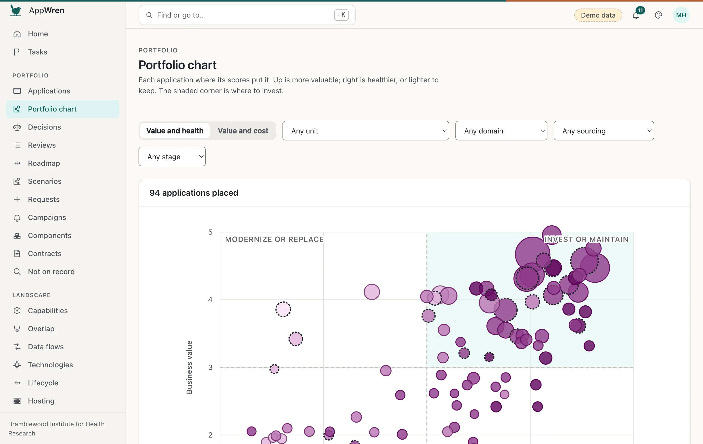

# AppWren

**Know every application, and what to do with it.**

AppWren is an open system of record for application portfolio management: one living record of every application an organization runs, who answers for it, what it is for, what it is built on, what it costs, and how healthy it is, turned into an explainable recommendation for each one: invest, maintain, tolerate, modernize, replace, consolidate, or retire.

It is built with particular care for research and health organizations that are not large corporations: research institutes, academic medical centers, universities, and the nonprofits around them, where software comes from vendors, central IT, and labs alike. Within them it is built first for the product, application, and engineering teams who own the software. Nothing in it is specific to either, and any organization that wants a lightweight, self-hosted portfolio system can adopt it.

- **The reasoning is on the screen.** Every score opens to its factors, levels, weights, and sources, and every recommendation to the rule that produced it.
- **People decide.** The system recommends; a named person records the disposition and why. Where they differ, both are shown.
- **Unknown is not zero.** Missing data is counted against confidence, never assumed, and too little of it means *Assess*, not a guess.
- **One definition of an application.** Applications, their components, and their deployments are separate records, so the portfolio compares like with like.
- **Judged by the right rubric.** A pilot is not judged like a system of record, nor research software like a commercial product.
- **Research-ready.** Grant funding and end dates, research continuity, research data classes, and single-maintainer risk are built in.
- **A history that cannot be quietly changed.** Every change is in an append-only, hash-chained log.
- **Quiet by default.** No scanners or agents; connectors to other tools only when an administrator turns them on.
- **Open and yours.** Apache 2.0, no paid edition, SQLite on a laptop or PostgreSQL on a server, and your own name and colors.

## Quickstart

You need [uv](https://docs.astral.sh/uv/), which provides the right Python (3.12 or later). Clone this repository, then run these from its directory:

```bash
uv sync                   # install AppWren
uv run appwren init       # write appwren.toml, create ./var and the database, create your administrator
uv run appwren doctor     # check the installation
uv run appwren serve      # run it at http://127.0.0.1:8000
```

`init` asks for your email address, your name, and a password of at least 12 characters. Open the address `serve` prints and sign in.

The administrator account sets the installation up: units, people, and appearance. To run the portfolio, give someone the manager role under Admin → People, and stewards and leaders for the units that will use it. Then bring in your applications from a spreadsheet. [Getting started](docs/getting-started.md) walks through all of it.

## Try the demo

To see AppWren with data in it before you set anything up, build the demo organization:

```bash
uv run appwren demo                                 # builds ./demo
uv run appwren --config demo/appwren.toml serve     # runs it at http://127.0.0.1:8020
```

The demo is the Bramblewood Institute for Health Research, a fictional research institute with a clinic and two years of history: 57 units, about 180 people, 107 applications (about forty of them research tools kept by labs), about 120 components, 24 technologies, about 125 assessments, 70 decisions, and four quarterly portfolio snapshots. Nothing in it is real.



Its sign-in page offers eight sample people and asks for no password. Try a few:

| Sign in as | To see |
|---|---|
| The portfolio manager | The dashboard, the portfolio chart, mismatches to review, and snapshots |
| The research applications steward | Specimen Tracker: recommended *Modernize*, with three flags, and every score's working |
| The clinical research leader | A decision that keeps an application the scores would replace, and why |
| The enterprise architect | The capability map, and technologies reaching end of support |
| The research software engineer | A member's view of the catalog, and the applications they keep |
| The auditor | Everything, read-only, with every change on record |

A demo listens only on the machine it runs on. See [Configuration](docs/configuration.md#the-demo-and-the-network) before changing that.

## What is in this release

Version 0.1.0 is the portfolio.

- **An inventory of applications** with a definition of what counts as one, a permanent reference, a unit, one accountable owner and the other people named on it, eight lifecycle stages each with what it requires of the record, and fields of the organization's own.
- **Components, technologies, and vendors:** each component records the technologies and releases it is built on, and each release its support dates, so technology currency is a fact rather than an opinion.
- **A capability map** of 43 capabilities to start from, with a primary provider for each, so overlap is found rather than guessed.
- **Assessment** through nine questions with a written definition for every level, *don't know* always an answer, and the scores worked out on the server as the answers change.
- **Four scores you can redo by hand:** business value, technical health, cost and burden, and risk exposure, each a weighted average of factors with their sources, coverage, and data confidence. Three profiles judge shared platforms and research software by the right rubric.
- **Recommendations** from ordered rules, with guardrails and nine kinds of flag, each naming the rule or facts behind it.
- **Decisions** by named people with the authority, never by an application's own accountable owner, each kept with the snapshot of the scores it was made against, and mismatches with today's recommendation shown side by side.
- **The portfolio chart, the dashboard, data quality, and Home,** where every figure is a link to the list it counts.
- **Import from a spreadsheet** with a dry run that reports every problem by row, and **export** of every list as CSV or JSON.
- **Sensitive fields and restricted applications,** withheld everywhere at once: records, lists, filters, charts, exports, and the working.
- **Roles and units:** seven roles, four of them limited to a unit and everything beneath it, and a hierarchy of any depth. Optional **single sign-on** through OpenID Connect, beside local accounts.
- **An append-only history** chained by hash, checked with `appwren verify`.
- **Branding and themes,** a JSON API under `/api/v1`, a command line for setup and recovery, and the program as a file.

The [roadmap](spec/roadmap.md) says what is next, and the [changelog](CHANGELOG.md) lists everything in each release.

## Documentation

Start with the [guide index](docs/README.md), or go straight to the guide for your part:

| Guide | For |
|---|---|
| [Getting started](docs/getting-started.md) | Whoever installs AppWren and sets it up |
| [The portfolio](docs/the-portfolio.md) | Everyone who keeps, assesses, or reads an application |
| [Running the program](docs/running-the-program.md) | The portfolio team, and administrators |
| [Configuration](docs/configuration.md) | Whoever runs the server |
| [API](docs/api.md) | Anyone connecting another system |
| [Command reference](docs/cli.md) | Every `appwren` command and option |

The design behind the product is in [`spec/`](spec/README.md): the [vision](spec/vision.md), the [engine](spec/engine.md), and the [roadmap](spec/roadmap.md).

## Development

```bash
uv sync                           # install AppWren and its development tools
uv run appwren serve --reload     # restart when the code changes
uv run pytest                     # the tests, on SQLite
scripts/test-both.sh              # the tests on SQLite and on a disposable PostgreSQL
uv run ruff check && uv run ruff format --check
node scripts/a11y-audit.mjs       # the accessibility audit, over a fresh demo
node scripts/keyboard-check.mjs   # the keyboard checks, over a fresh demo
node scripts/capture.mjs          # the documentation's screenshots, from a fresh demo
```

See [CONTRIBUTING.md](CONTRIBUTING.md) for how the work is organized, and [SECURITY.md](SECURITY.md) to report a vulnerability.

## License

Apache License 2.0. See [LICENSE](LICENSE) and [NOTICE](NOTICE).
