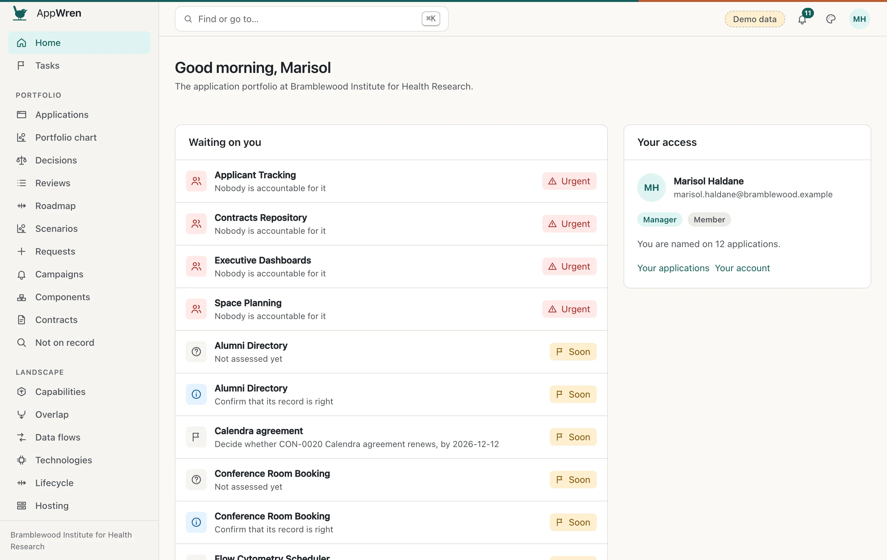

# Getting started

This guide takes you from nothing to a working portfolio: AppWren installed, your organization's units and people in it, your applications brought in with the people who answer for them, and the first scores and decisions. It is for whoever installs AppWren and sets it up for their organization. Installing takes about fifteen minutes; loading an organization, an afternoon with the spreadsheets at hand.

The steps are in the order that works, since each one uses what the one before made: units, then people, then the applications that name them.

If you only want to look around first, skip to [Explore the demo organization](#explore-the-demo-organization). If you are still deciding whether to adopt AppWren, and how, read [Adopting AppWren](adopting.md) first.

## What you need

- [uv](https://docs.astral.sh/uv/), which provides the right Python (3.12 or later).
- A copy of this repository.

Every command in these guides is run through `uv run appwren …` from the repository directory. The full list is in the [command reference](cli.md).

## Install

```bash
uv sync
```

To use PostgreSQL rather than SQLite, install its driver as well, with `uv sync --extra postgres`, and see [Use PostgreSQL](configuration.md#use-postgresql) before the next step. SQLite is plenty to begin with, and an installation can be [moved](configuration.md#move-to-another-database) later.

## Start from a program shaped like yours

Decide this before the next step. The **program** is what AppWren asks and how it judges: its lists of values, what each lifecycle stage requires, which fields are sensitive, a capability map, the assessment's questions, and the scoring model. `init` loads one, and a later `init` does not load another over it.

The default program suits a research organization with some clinical work. If yours is another kind, begin from a **starter program** instead: the default program as that kind of organization would first change it, with its own capability map, domains, kinds of unit, data classes, funding, and examples of what counts as an application. The question bank, the scoring model, and the lifecycle are the default's, so every application is assessed and scored the same way.

| Starter | For |
|---|---|
| `starter-research-institute` | An independent research institute: labs and core facilities, grant-funded software, research data |
| `starter-academic-medical-center` | Hospitals and clinics beside research and teaching, a fuller clinical map, tier 1 kept for patient care and safety |
| `starter-university` | Colleges, schools, and departments; teaching and student services beside research; student records as their own class of data |
| `starter-nonprofit` | Programs and the people they serve, fundraising and donors, volunteers, restricted funding |
| `starter-company` | Customers, products, and operations, corporate functions, customer and payment data |

```bash
uv run appwren program starters                  # what each is for
```

Then give the one you chose to `init` with `--program`, as below. A starter is a beginning, not a commitment: everything in it can be changed afterwards like any program ([Shape the program](running-the-program.md#shape-the-program)). The values of the default program that a starter leaves out are kept, retired, so nothing that refers to them breaks. If you set up with the default and change your mind, load a starter over it with `uv run appwren program import starter-university`; run it with `--dry-run` first to see what it would change.

## Set up the installation

```bash
uv run appwren init --program starter-university   # or leave --program out for the default
```

`init` does six things:

1. Writes `appwren.toml`, the deployment settings, in the current directory.
2. Creates the data home, `./var`, which holds everything that is not in the database.
3. Creates the database. With no other setting, this is a SQLite file inside the data home.
4. Asks for your organization's name, and a first unit within it if you wish, such as your team. Every application belongs to a unit, so this is the least you need to add one. Each is given a short **code** from its initials (*Northwind Institute* is `NI`), which imports and the command line use to name it; change it under **Admin → Units** if you like. Press Enter to skip, and add units later.
5. Loads the program: the default, or the starter you named.
6. Asks for your email address, your name, and a password, and creates the first administrator.

The password needs at least 12 characters. Length matters more than symbols: a few unrelated words make a good one.

`init` is safe to run again. It leaves an existing configuration file alone, adds only what is missing from the program, creates units only if there are none, and creates an administrator only if there is none.

To set up without being asked anything, name everything and pipe the password in:

```bash
printf '%s' "$ADMIN_PASSWORD" | uv run appwren init --program starter-university \
  --organization "Your Organization" --first-unit "Your Team" \
  --admin-email you@example.org --admin-name "Your Name" --password-stdin
```

## Check it

```bash
uv run appwren doctor
```

`doctor` checks the configuration, the data home, that the database answers, that its schema is the one this version expects, that the database still refuses changes to the history, and that the history verifies. It lists every problem it finds, and exits with 1 if anything must be fixed.

## Run it

```bash
uv run appwren serve
```

The server prints its address, by default `http://127.0.0.1:8000`. Use `--port` to pick another port.

`serve` refuses to start in three cases, and says what to do in each:

| It says | Do this |
|---|---|
| The database schema is behind | `uv run appwren db upgrade` |
| There is no administrator yet | `uv run appwren users add you@example.org --name "Your Name" --role admin` |
| The port is already in use | Stop what is using it, or pass `--port` |

As installed, AppWren listens only on the machine it runs on, which is right while you set it up. [Put it in front of other people](#put-it-in-front-of-other-people) says what to do before others sign in.

## Sign in for the first time

Open the address in a browser and sign in with the email address and password you gave `init`.

AppWren signs in with local accounts: an email address and a password that it keeps. Nothing else has to be installed or connected. Signing in with your organization's identity provider, such as Microsoft Entra ID, is optional and can be added at any time: see [Single sign-on](configuration.md#single-sign-on).

- Five failed attempts within fifteen minutes stop sign-in for that account from that address for a few minutes.
- A sign-in ends after 12 hours without activity, and after 7 days in any case. Both are [settings](configuration.md#server).
- To change your password, open the account menu at the top right and choose **Your account**. Changing it signs out your other sessions.
- If you cannot sign in at all, reset the password from the command line: `uv run appwren users reset-password you@example.org`.

## Set up the organization

Do these in order. Units and people are an administrator's to load; applications are loaded by someone with a portfolio role, which step 3 gives you.

### 1. Units

**Admin → Units** holds the organization as a hierarchy of any depth: divisions, departments, centers, core facilities, labs, clinics, offices, and teams. Every application belongs to a unit, roles can be limited to a unit and everything beneath it, and figures roll up the tree.

Add them one at a time with **Add a unit**, or load them all from a CSV file with **Import**:

```text
code,name,kind,parent_code
NI,Northwind Institute,organization,
RES,Research,division,NI
RC,Research Computing,team,RES
HR,Human Resources,department,NI
```

| Column | Holds |
|---|---|
| `code` | A short code, unique, that other files and the command line use to name the unit. Required |
| `name` | Its name, as people know it. Required |
| `kind` | Its kind, from the program's list of kinds of unit (see **Admin → Program → Lists**), by its key or its label. Required |
| `parent_code` | The code of the unit it sits within. Empty for the organization itself, which is the only unit without one |

Parents may come before or after their children. Units are matched by code, so importing the same file again updates them. The organization `init` made is the file's top row: if it has no code yet, the row gives it one.

Add the departments that *use* your applications as well as those that keep them, even if nobody in them will sign in, so that each application can say who uses it and the dashboard can be read by department.

### 2. People and roles

**Admin → People** adds accounts and gives them roles. Everyone who signs in is a **member**: they can read the catalog and keep the applications they are named on. A role adds to that:

| Role | What it is for |
|---|---|
| **Manager** | The portfolio team. Edits any application, records decisions, and, for the whole organization, takes portfolio snapshots, makes leadership reports, and shapes the program. May be limited to a unit, and then does the first two within it |
| **Architect** | Keeps the records the whole organization shares (capabilities, technologies, vendors, hosting platforms, and funding sources) and assesses applications. May be limited to a unit |
| **Leader** | Leads a unit, which the role must name. Sees it and everything beneath it, and records decisions for its applications |
| **Steward** | Keeps a unit's applications complete and current: adds, edits, imports, and assesses them. The role must name its unit |
| **Auditor** | Reads everything, including the full history and leadership reports, and changes nothing |
| **Admin** | Accounts, units, sign-in, appearance, connectors, API tokens, webhooks, and scheduled work. An administrator also reads everything and may shape the program, but does not add, keep, or decide about applications without another role |

[Running the program](running-the-program.md#roles-and-scope) says exactly what each role may do.

Load people from a CSV file with **Import**:

```text
email,name,title,unit_codes,roles
ada.ng@example.org,Ada Ng,Portfolio manager,RC,manager
sam.okoro@example.org,Sam Okoro,Research applications lead,RES,steward=unit:RES
lee.park@example.org,Lee Park,Director of Research,RES,leader=unit:RES
kim.diaz@example.org,Kim Diaz,Research software engineer,RC,
```

| Column | Holds |
|---|---|
| `email` | The address they sign in with. People are matched by it. Required |
| `name` | Their name. Required |
| `title` | Their job title |
| `unit_codes` | The units they work in, by code, separated by `;`. This says where they belong; it grants nothing |
| `roles` | Their roles, separated by `;`: `admin`, `manager`, `architect`, `auditor`, `steward=unit:CODE`, `leader=unit:CODE`, and `manager=unit:CODE` or `architect=unit:CODE` for one limited to a unit. Empty for a member |

The same can be done one person at a time on the command line, which is handy in a script: `uv run appwren users add sam.okoro@example.org --name "Sam Okoro" --role steward=unit:RES --invite`.

**How people get in.** A person added by an import, or with `--invite`, is *invited*: they can be named on applications at once, but they have no password, and AppWren sends no invitation. Either:

- **give each a password** under **Admin → People**, with **Set a password** beside them, and tell them it, asking them to change it under **Your account**; or
- **turn on [single sign-on](configuration.md#single-sign-on)**, and they sign in with the organization's own accounts. Their roles can come from the identity provider's groups.

Until they can sign in, they can still be named on records, and what is waiting on them is kept for when they do.

### 3. Give yourself the roles for the portfolio work

The administrator account sets the installation up; it does not add or keep applications. If you are also on the portfolio team, give your own account the **manager** role for the whole organization under **Admin → People**. A manager limited to a unit cannot take portfolio snapshots or shape the program.

### 4. Vendors

An application file names its vendor by name, and the vendor must be on record first. Add the vendors your spreadsheet names under **Landscape → Vendors → Add a vendor**: its name and kind are enough to begin. Vendors are shared records, which architects and managers keep. A row whose vendor is not on record is refused, saying so.

### 5. Bring in your applications

Most organizations start from a spreadsheet. Save it as CSV, with a header row, and open **Portfolio → Applications → Import**.

```text
Name,Unit,Accountable owner,Lifecycle stage,Sourcing,Criticality tier,Vendor,People who use it,Data it handles
Grant Tracker,RES,sam.okoro@example.org,Active,saas,2,Fundwise,140,personal;financial
Lab Notebook,RC,kim.diaz@example.org,Active,built_here,3,,60,deidentified_research
```

A column is matched to a field by its heading, which may be the field's label as the record shows it (*Criticality tier*, *Data it handles*), its name (`tier`, `data_classes`), or a heading people often use for it (*Owner email*, *Department*, *Description*). These are the ones that matter most:

| Column | Holds |
|---|---|
| Name | Required on every row, even one that updates by reference |
| Unit | The unit that answers for it, by code or by name. Required for a new application |
| Accountable owner | The email address of the person who answers for it. They must already have an account (step 2). Leave it empty and **you**, the person importing, become accountable, which also means you may not record its decision unless the program lets owners decide |
| Reference | An application's reference, such as `APP-0042`, to update it. A row without one adds an application; a row with a reference not yet on record adds one under that reference |
| Lifecycle stage, Sourcing, Criticality tier, Data it handles, and the program's other lists | A value's key or its exact label, as **Admin → Program → Lists** shows them (`saas` or *Software as a service*). Where a field takes several, separate them with `;` |
| Vendor | A vendor already on record, by name (step 4) |
| Tags | Separated by `;` |

Then:

1. **Check the file.** Nothing is loaded; every problem is reported by row, such as a unit or an owner that is not on record, or a value that is not one of a list's choices.
2. Fix the file, and check it again until there are no problems.
3. **Import.** Every row is loaded, or, if anything is wrong, none is.

A row is added at the stage it names, or *Active* if it names none, even if it lacks what that stage requires: what it lacks shows under **Reports → Data quality** and on its owner's Home. See [Import and export](the-portfolio.md#import-and-export) for every column, the export, and the API.

Capabilities are not part of the file. Map each application to what it does on its record, under **Capabilities**, or ask its owners to: until then its overlap with others, and how unique it is, are unknown.

### 6. Fill in what the scores need

An application's scores are worked out from its assessment and its record, and come with a **confidence**: how much of what they read is known. Below the model's threshold (70 out of 100 unless your program changes it), the application is recommended only *Assess*, with the reason *Not enough data*. An assessment alone rarely reaches it: the record's facts count as well: its tier, how many people use it and can maintain it, the data it handles, its sign-in, monitoring, and backup, its annual cost, what its components are built on, and its capabilities.

So, for each application:

- **Answer its assessment**: its **Assessment** part, nine questions that anyone who keeps it answers: the people named on it, a steward of its unit, or an architect or manager in scope. See [Assessment](the-portfolio.md#assessment).
- **Fill in the facts the assessment cannot know**, on the record or by importing them as further columns.
- **Read the working**: every score opens to show which facts and answers it used, which were missing, and what would raise its confidence.

A stage also requires certain facts of a record: an Active application, for instance, its sign-in, monitoring, backup, users, maintainers, domain, pace, what it is built on, and an assessment. **Reports → Data quality** shows, unit by unit, what is missing and opens the list of each.

### 7. Tell people, and let them keep their applications

Each person named on an application sees on **Home** what it asks of them: assessments to answer, facts its stage requires, a record to confirm. Without email, they hear nothing until they sign in. Set up [email](configuration.md#email) so that reminders and notices reach them, or tell them yourself where to look. A first [campaign](keeping-current.md#campaigns), asking every owner to confirm their records by a date, is a good way to start.

### 8. Record the first decisions

Once an application's scores have the confidence they need, its recommendation is *Invest*, *Maintain*, *Modernize*, *Consolidate*, *Replace*, or *Retire*, with the rule that produced it. A leader of its unit, or a manager whose scope includes it, records what will actually happen with **Record a decision** on the record; its **Decisions** part keeps every one. The decision may differ from the recommendation, with the reason. See [Decisions](the-portfolio.md#decisions).

### 9. See that it is working

- **Reports → Data quality** falls as owners fill their records.
- **Reports → Dashboard** counts recommendations, decisions, and flags, and each figure opens the list it counts.
- **Home** for each role shows what is waiting on them.

From here, [the program handbook](handbook.md) sets out the first ninety days and the yearly rhythm of reviews, campaigns, and reports.

### Appearance

**Admin → Appearance** sets the product's name, your organization's name, a logo for light and for dark, an accent color, the default palette, a message on the sign-in page, and links at the foot of every page. When the look has to be exact, it is set in the configuration file instead. See [Appearance](running-the-program.md#appearance) and [`[branding]`](configuration.md#branding).

## Start with one team

AppWren does not need the whole organization to begin. A single team that keeps a few dozen applications can use it for its own, and the rest of the organization can join later without anything being redone.

1. **Make the organization the top unit, and the team a unit within it.** `init` asks for both (or pass `--organization` and `--first-unit`). The organization is only a name until others join. If you began with the team at the top, **Admin → Units → Put a unit above the top** adds the organization above it later, with everything beneath the team moving with it.
2. **Add the departments that use your applications** as units with nobody in them, so that each application can say who uses it, and the dashboard and data quality can be read by department later.
3. **Give the team's lead two roles** under **Admin → People**: *administrator*, and *manager* for the whole organization.
4. **Name the rest of the team** on the applications they keep, or make them stewards of the team's unit to keep all of its applications.
5. **Bring in your applications** from a spreadsheet, as above.
6. **Retire what does not fit** of the starter capability map: open a capability, choose **Edit**, and set its status to retired. Add your own as you need them.

SQLite and the one server process `init` sets up are plenty for a team. Move to [PostgreSQL](configuration.md#use-postgresql) when more of the organization joins.

One rule needs a thought in a small team: **by default, nobody records the decision about an application they are accountable for.** If the lead is both the owner of the team's applications and its only manager, either name another member accountable for the applications the lead will decide on, or turn on **Admin → Program → Decisions**, which lets an owner who is also a manager or leader decide about their own application. Each such decision is marked *Recorded by its own owner*, so anyone reading it later knows.

## Put it in front of other people

Before anyone else signs in, the installation needs an address they can reach, served over https, and backups. In short:

1. **Choose the database.** SQLite serves a team or a department on one server process; for more people at once, use [PostgreSQL](configuration.md#use-postgresql).
2. **Set `[server] base_url`** to the address people will use, such as `https://apps.example.org`, so that links in email and single sign-on come back to it.
3. **Put a reverse proxy in front** that serves https and passes requests to AppWren on the same machine: see [Run behind a reverse proxy](configuration.md#run-behind-a-reverse-proxy). The [deployment recipes](configuration.md#deploy) give a container image, a compose file with PostgreSQL, and a service unit.
4. **Back it up** on a schedule, and copy the backups off the machine: see [Back up and restore](configuration.md#back-up-and-restore).
5. **Run `uv run appwren doctor --production`**, which checks what matters once people depend on it, and fix what it reports.

[Configuration](configuration.md) covers each in full.

## Explore the demo organization

To see AppWren with data in it before you set anything up, build the demo:

```bash
uv run appwren demo                                 # builds ./demo
uv run appwren --config demo/appwren.toml serve     # runs it at http://127.0.0.1:8020
```

The demo is the Bramblewood Institute for Health Research, a fictional research institute with a clinic and two years of history: 57 units, about 180 people, 109 applications (about forty of them research tools kept by labs), about 120 components, 24 technologies, 24 interfaces, 89 deployments on six hosting platforms, 22 contracts, about 140 assessments, 65 decisions, and four quarterly portfolio snapshots. There is an application to modernize with three flags, three survey tools doing one job, a grant about to end, software kept by one person, a pilot, a decision that differs from its recommendation, four applications whose owner left, a dozen never assessed, a database release reaching end of support next quarter, research data flowing into dashboards whose record does not list it, a contract whose notice date is two weeks off, health data with no data agreement, and five thousand licenses of which fourteen hundred are used. Some applications are used by everyone, some by one lab or a few departments, and some by kinds of people across the institute, such as the two Human Resources registered in the last week: time tracking for hourly employees and contractors, and performance reviews for managers and leaders. And keeping it current: a score of records nobody has confirmed in time, a campaign under way in the shared resources and one closed in the clinic, tasks for a notice date, a release ending, grants ending, and the four applications left without an owner, and a score contested and answered. And planning change: two quarterly reviews closed with what they decided and the next one planned, a dozen initiatives on the roadmap, five requests for something new from approved to just in, and three retirements, one done with its savings and one past its date. Nothing in it is real, and every record was made by the same code the app uses, so its history verifies like any other.



Its sign-in page offers eight sample people and asks for no password:

| Sign in as | To see |
|---|---|
| The portfolio manager | The dashboard with what everything costs, the portfolio chart, mismatches to review, contracts and their notice dates, overlap, snapshots, campaigns and tasks, and the program to shape |
| The enterprise architect | The capability map and its measures, data flows, the lifecycle timeline and radar, hosting platforms, the picture of how anything is connected, and a contest waiting for an answer |
| The chief information officer | Decisions for Information Technology's applications, and the reviews coming due |
| The clinical research leader | A decision that keeps an application the scores would replace, and why |
| The research applications steward | Specimen Tracker: its scores and their working, what would break if it went, where it runs, and what it costs line by line; and what a campaign asks of them |
| The research software engineer | A member's view: the applications they keep, and the costs and contracts they may not see elsewhere |
| The auditor | Everything, read-only, with every change in one place under Reports, History |
| The administrator | People, units, sign-in, appearance, and scheduled work, and no part in the portfolio's judgments |

`appwren demo --seed 2` builds a different Bramblewood with the same shape, and `--force` rebuilds one that is already there.

A demo listens only on the machine it runs on. See [Configuration](configuration.md#the-demo-and-the-network) before changing that.

## Next

- To record applications, assess them, read their scores, and record what they cost, read [The portfolio](the-portfolio.md).
- To record what passes between them, where they run, and what falls out of support, read [The landscape](the-landscape.md).
- To keep the record current, with reminders, confirmations, campaigns, and tasks, read [Keeping current](keeping-current.md).
- To run the program over its first months and years, read [The program handbook](handbook.md).
- To decide who sees what, and to shape the questions and the scoring model, read [Running the program](running-the-program.md).
