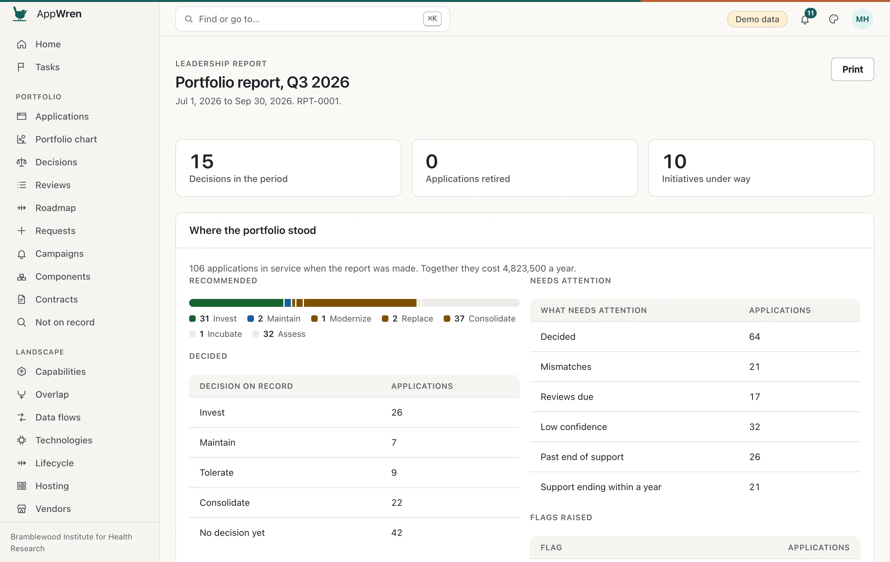

# Insight

This guide is for the portfolio team and for leadership: those who ask how the portfolio is moving, where its cost and use are concentrated, and what happened over a quarter. It covers trends between snapshots, an application's scores over time, shares of the portfolio, leadership reports, and the record as it stood on a past day.

Everything here is read from what AppWren already keeps. A portfolio snapshot keeps every scored application's scores as they were ([Portfolio snapshots](running-the-program.md#portfolio-snapshots)); a decision keeps the scores it was made on; and a leadership report, once made, keeps every figure in it. None of it is worked out again later from the records as they have since become.

## Trends

**Reports → Trends** puts two portfolio snapshots side by side, or one snapshot and today. For each it shows how many applications were scored, how many by recommendation, how many with low confidence, and the average of each score. Between them it lists:

| What moved | What it means |
|---|---|
| Recommendation changed | Today's recommendation, or the later snapshot's, differs from the earlier one's |
| Scores moved | A score rose or fell by half a point or more |
| Flags raised or cleared | A flag came or went |
| Added or gone | Scored in one and not the other |
| Decided between them | Every decision recorded after the earlier snapshot was taken, up to the later one |

Each person sees what they may see: an application they cannot open is neither listed nor counted.

An application's **Scores** part shows its scores over time, a point for each portfolio snapshot and each decision, as a picture and as a table.

## Shares of the portfolio

**Reports → Shares of the portfolio** names the applications at one end of the portfolio in service:

| Share | Ranked by |
|---|---|
| The costliest tenth | Annual cost |
| The dearest tenth per user | Annual cost for each person who uses it |
| The least used fifth | Its count of users |
| The oldest fifth | Years since it went live |

Each share is worked out from the applications that have the figure it ranks by, and says how many do not. A share says where an application stands against the rest, not whether it costs too much or is used too little: that is for the scores and their defined bands ([The scores](the-portfolio.md#the-scores)), and a share never feeds a score. Cost is left out for anyone who may not see it.

## Leadership reports

A **leadership report** says, for a period, where the portfolio stood and what happened in it. A manager makes one under **Reports → Leadership reports**, with a title and a period that has ended, often the last quarter (which is suggested). It holds:

- **Where the portfolio stood** when it was made: the applications in service, what they cost together (for those who see every cost), how many by recommendation and by decision on record, what needs attention, the flags raised, and engineering maturity.
- **How the scores moved**: from the last portfolio snapshot before the period, or its first, to its last, with the change in each average score and how many applications changed recommendation, moved on a score, or raised or cleared a flag.
- **The decisions in the period**, by what was decided, and how many went another way than recommended.
- **The reviews closed in it**, the initiatives under way (and any past their end) and done, the requests for something new, and the applications retired in it, with what they save a year.

A report is **worked out once, when it is made, and kept whole**. Reopening it reads what was kept, never the records as they are now, so a report read a year later says what it said then. Its **digest**, the SHA-256 of what it holds, is printed at its foot and checked whenever it is opened; a report that no longer matches says so.

**Print** prints the report without the menus and buttons. Reports are read by those who may see every record (managers, auditors, and administrators), as they name applications from across the organization.

## As of a day

**Reports → As of a day** shows the applications that were in service at the end of a chosen day (the end of the last quarter, unless another is chosen): each as it was named then, its unit and stage then beside its stage now, and the decision on record then beside the decision now. It says how many have come into service since and how many have left.

Nothing is kept for this. Every change to a record is in its history with the values before and after, and the record on a day is those changes, up to the end of that day, applied in order. The decision on a day is the one recorded last by then; the scores are those of the nearest portfolio snapshot taken on or before it.

An application's **History** part offers **As it stood on a day**: each of its values then beside its value now, those that have changed first, the decision on record then, its scores in the snapshot of the time, and how many changes have been made since. A value someone may not see now, such as cost, is not shown for then either.

## Next

- [Running the program](running-the-program.md#portfolio-snapshots): taking portfolio snapshots.
- [The API](api.md#insight): the routes for trends, shares, and reports.
