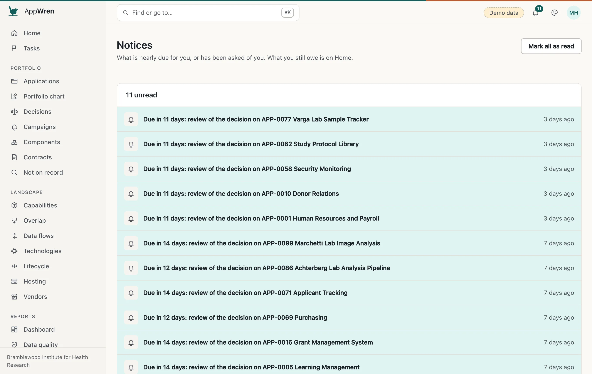
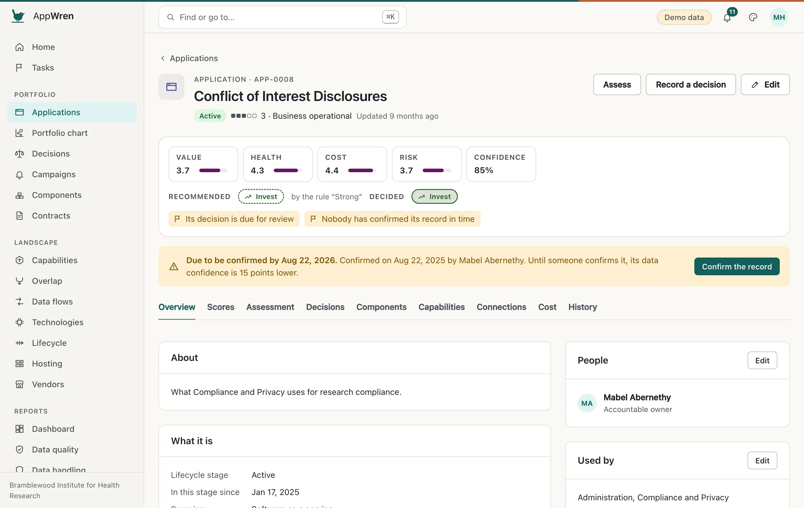
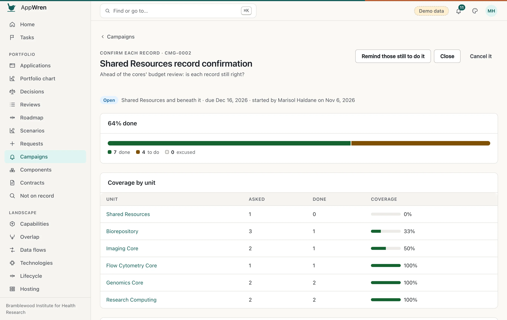
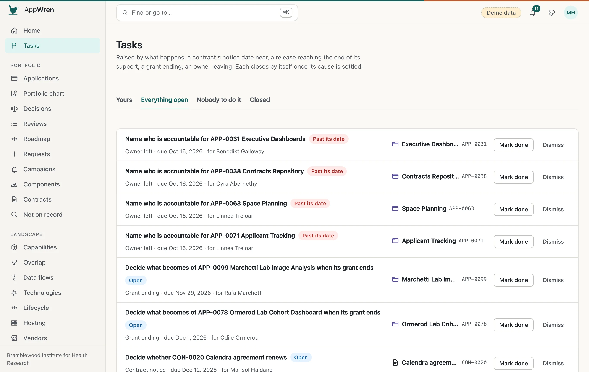
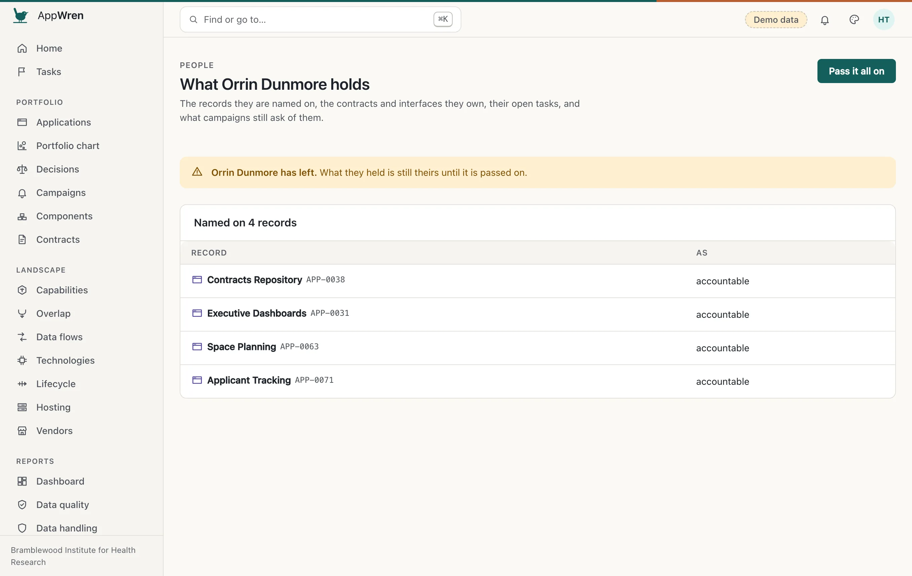
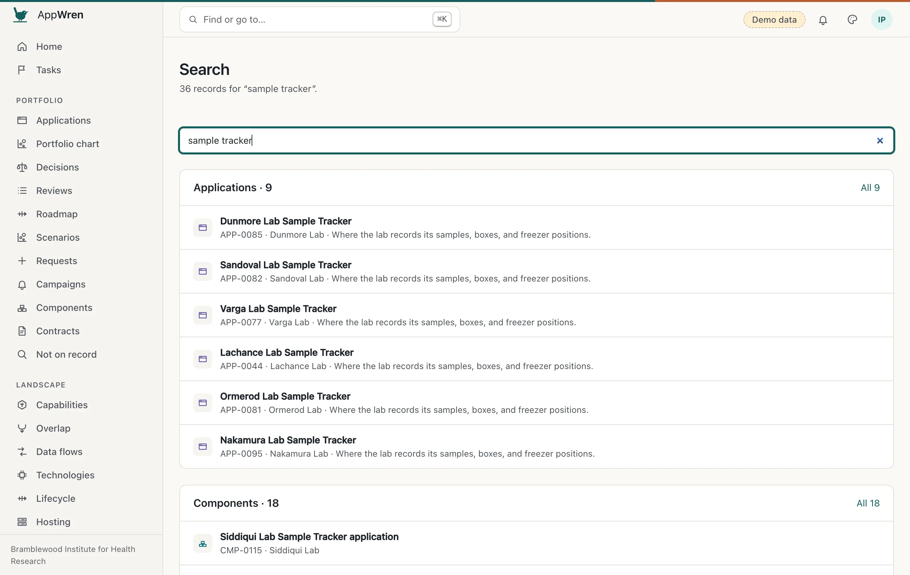
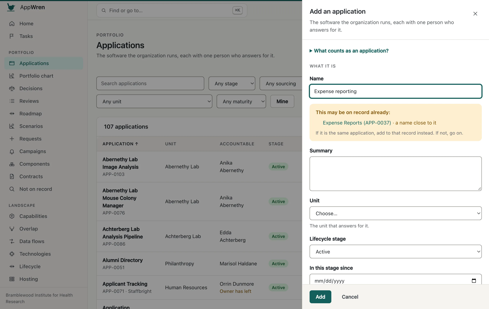
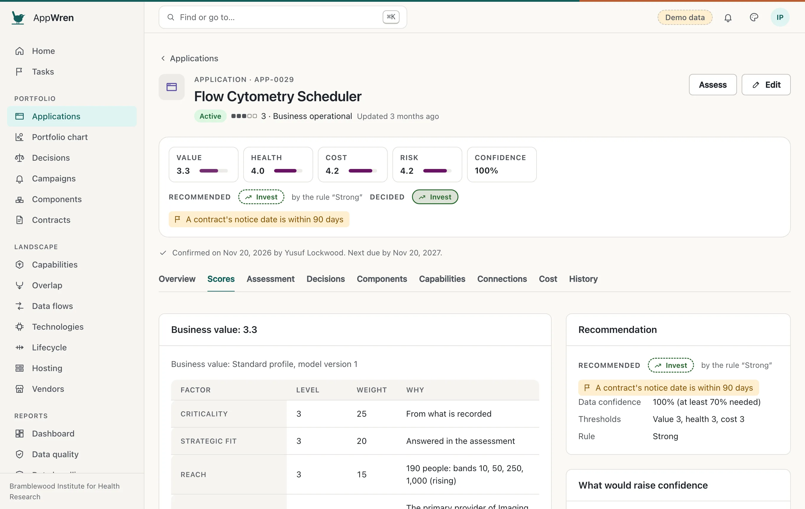

# Keeping current

This guide is for everyone who keeps an application, and for the portfolio team. It covers how AppWren keeps the record true without a central team chasing it: what is waiting on you and how you are told, confirming a record, campaigns, the tasks that what happens raises, passing on what someone holds, finding anything, and saying a score is wrong.

## What is waiting on you

**Home** lists what is yours to do, most urgent first: an application not assessed or whose assessment has expired, a record due to be confirmed, a task, what a campaign asks of you, a flag on one of your applications, what a record lacks for its stage, and a [portfolio review](planning-change.md#portfolio-reviews) you run that is coming up.

The **bell** in the top bar counts what is new for you. It opens **Notices**: each reminder, task, campaign, and answer, newest first, with a link to where to act.

### Reminders

Whoever something waits on is reminded two weeks before its date, and again the day after it passes. What stays late goes up.

| What has a date | Who is told | If it stays late |
|---|---|---|
| An assessment about to expire | Whoever is accountable for the application | The unit's steward after a week, its leader after three |
| A record due to be confirmed | Whoever is accountable for the application | The same |
| A decision's target date | Whoever is accountable for the application | The same |
| A decision's review date | Whoever decided, or the unit's leaders if they have gone | It stays with them |
| A task | Whoever the task is for | The unit's steward, then its leader, where the task is about an application |
| What a campaign asks | Whoever was asked | The unit's steward, then its leader |

Each is said once for a given date; moving the date starts again. The periods are part of the scoring model's cadence, which the portfolio team can change on **Admin → Program**.

### By email, if you wish

Where email is set up, choose under **Your account** to have each notice as it happens, one summary a day, or none. Everything is always under the bell as well. Without email, nothing is sent and nothing is lost: see [Configuration](configuration.md#email).

## Confirm the record

Every so often, the people who keep an application say that its record is right: its details, the people named on it, its components and what they are built on, what it sends and receives, where it runs, and what it costs. If something is wrong, put it right first, then confirm.

Below an application's scores, a line says when its record was last confirmed, by whom, and when it is next due. Choose **Confirm the record**, add a note if you wish, and confirm.

| Tier | Confirmed every |
|---|---|
| 1 and 2 | 6 months |
| 3, 4, and 5 | 12 months |

The people named on an application, its unit's stewards, and managers may confirm it.

A record past its date is **stale**, and says so where everyone can see it:

- the line below its scores turns to a warning;
- its **data confidence is 15 points lower**, and *Confirm the record* heads what would raise it; below 70%, the recommendation becomes *Assess*;
- it is flagged, counted as *Not confirmed in time* in data quality, listed on Home for the people named on it, and reminded of.

A record that has never been confirmed is due one period after it was added, or after the day AppWren began asking, whichever is later. So an upgrade makes nothing stale on its first day.

## Campaigns

A **campaign** asks the people who answer for the applications in a unit to confirm their records, or to assess their applications, by a date. Managers and stewards run them over the units they hold their role for: under **Portfolio → Campaigns**, choose **Start a campaign**.

- Choose what to ask, the unit (everything beneath it is included), and, if you wish, only certain tiers or stages, a date, and a note.
- Before you start it, it says how many people it would ask about how many applications, and names any application with nobody to ask.
- Each application goes to whoever is accountable for it, or to a steward of its unit if they have gone. Each person is told once, with a count, and finds what is asked of them on Home.

There is nothing to tick. An application is done when its record is confirmed, or it is assessed, after the campaign began: on its own page, as usual.

The campaign's page shows its progress and its **coverage by unit**, least covered first: each unit's figures open its own list. Whoever runs it can remind those still to do it, **Excuse** an application with a reason, **Close** it (what was done is kept), or cancel one started in error.

## Tasks

Some things need someone to act because of what has happened, not because of a date anyone set. Each hour AppWren looks, and raises a **task** for the person who must act, with a date and the reason, and tells them.

| What happens | Raised | For | Settled when |
|---|---|---|---|
| A contract's notice date is near | 60 days before it | The contract's owner | The term changes (it was renewed) or it ends |
| A release in use nears its end of support | 180 days before, for each application on it | Whoever answers for the application | Nothing of it runs on that release any more |
| A grant nears its end | 180 days before, for each application it pays for | Whoever answers for the application | A decision on the application is recorded |
| An accountable owner leaves | When their account is disabled | A steward of the unit, or a manager | Someone is accountable again |

A cause raises one task, never two. A task closes by itself when its cause is settled, or by whoever it is for (or a steward or manager over it) with **Mark done** or **Dismiss** and a note. How far ahead each is raised is part of the cadence.

**Tasks** lists yours, everything open you may see, those with nobody to do them, and those closed.

## When someone leaves

Disabling an account does not move anything by itself: each application they were accountable for shows that nobody is, and a steward is given a task to name someone.

Every person has a page of **what they hold**: the records they are named on and in what role, the contracts and interfaces they own, their open tasks, and what campaigns still ask of them. Open it from **Admin → People**, or from a notice. An administrator or a manager can **Pass it all on** to one person in one step; that person is told. Assessments and decisions are not passed on: each stays the statement of whoever made it.

## Find anything

Press **⌘K** or **Ctrl K**, or **/**, and type: the command palette finds pages, actions, and records. **Search everything** lists every kind of record that matches, the best answer first, by name, reference, summary, or what something is called in another system. You find only what you may open.

### Saved views

Filter any list as you want it, then save it under a name from its **Views** button, to come back to it. Stewards, architects, and managers may share a view with everyone. A view keeps the question, never the answer: whoever opens it sees only what they may.

### Likely duplicates

While an application is added or renamed, AppWren shows any already on record whose name or alias is close to the new name, or that are the same product from the same vendor. If it is the same application, add to that record instead.

## Contest a score

If a factor of an application's scores is wrong, say so. On its **Scores** part, choose **Contest a factor**: which factor, what it should be, why, and a link to the evidence. Whoever keeps the application may.

The portfolio team (a manager or an architect over its unit) sees it on Home and answers: they accept it, saying what will be changed, or they answer it, saying why not. You are told either way, and both stay on the record and in its history.

A contest does not move a score. Scores come from the record and the assessment, so a contest that is right is put right there.

## Next

- For who may do each of these, read [Roles and scope](running-the-program.md#roles-and-scope).
- To change the periods, the penalty, or how far ahead tasks are raised, read [Shape it in the app](running-the-program.md#shape-it-in-the-app).
