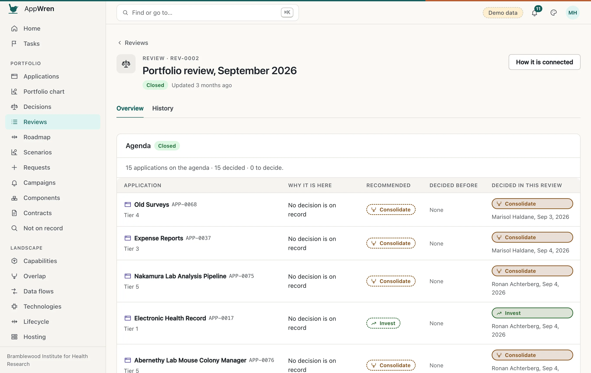
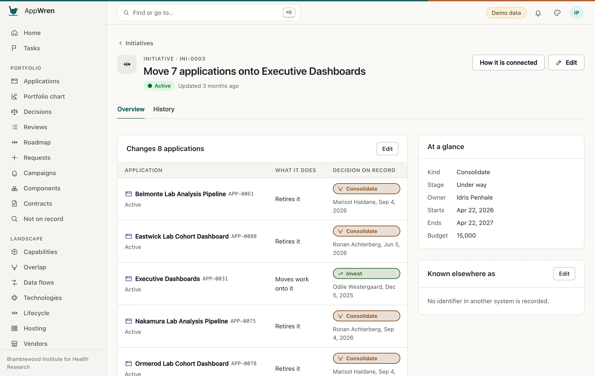
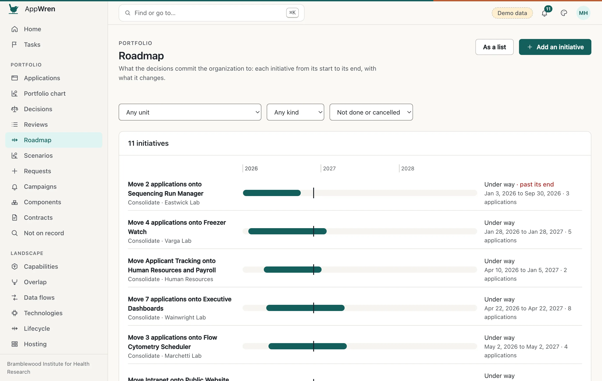
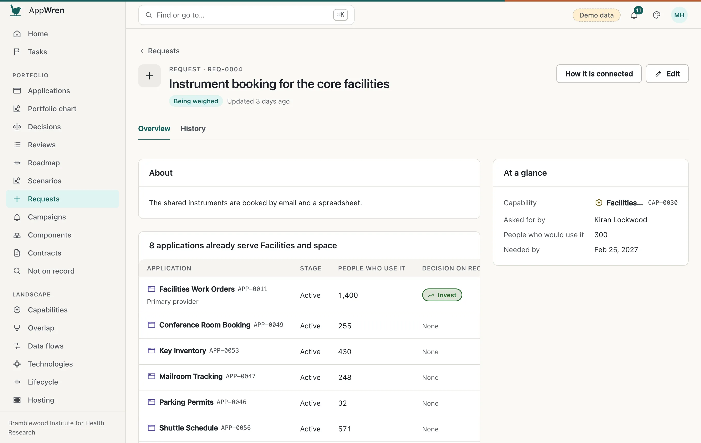
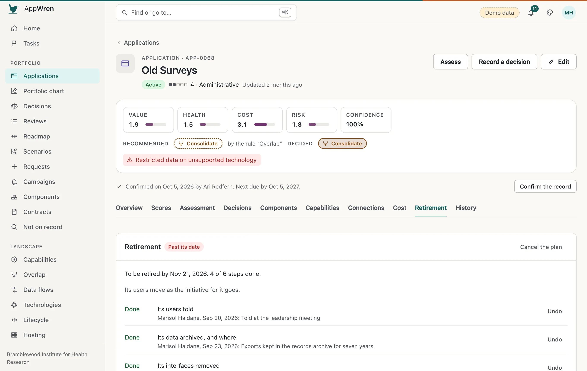

# Planning change

This guide is for the people who decide what happens to applications, and for those who carry it out. It covers portfolio reviews, initiatives and the roadmap, requests for something new, stage gates, and retiring an application.

A decision says what to do with an application ([Decisions](the-portfolio.md#decisions)). This part of AppWren carries it through: the portfolio is reviewed with an agenda drawn from what needs deciding, what is decided becomes an initiative with dates, a request for something new is checked against what is there before anything is bought, an application cannot move on without what its next stage requires, and a retirement is a plan that ends with its savings on record.

## Portfolio reviews

A **review** is a meeting about a unit's applications, and the record of what it decided. Under **Portfolio → Reviews**, a manager, or a leader of the unit, plans one: its name, the unit (with everything beneath it), the date, a chair, and, if wished, only certain tiers.

**Draw the agenda** adds the applications in its scope that need deciding:

| Why it is on the agenda | What that means |
|---|---|
| The decision on record differs from today's recommendation | Its decision and its scores no longer agree ([Mismatches](the-portfolio.md#mismatches)) |
| Its decision is due for review | Its decision's review date falls on or before the review |
| No decision is on record | It is in service and nobody has said what to do with it |
| Added by hand | Someone put it there, with a note of what to decide |

Drawing again adds only what is new; anything can be added or taken off until the review closes. Each item shows what was recommended and what was decided before.

**Open the review** when it starts. From then until it closes, a decision recorded for an application on the agenda, from the review's page or anywhere else, is shown on its item. A review does not change what a decision is, or who may record one ([Decisions](the-portfolio.md#decisions)). **Close the review** when it ends: each item keeps the decision taken on it, and a closed review changes no more. A review coming up within two weeks is on **Home** for the people who run it.

## Initiatives and the roadmap

An **initiative** is a planned change: a modernization, a migration, a consolidation, a replacement, a retirement, or another. It is a record of its own (`INI-0001`), with a unit, an owner, a stage (proposed, approved, under way, done, cancelled), dates, and a budget, and it names the applications it changes and what it does to each: **changes it**, **retires it**, or **moves work onto it**. Each is shown with the decision on record for it. An application's page lists the initiatives that change it.

A decision to modernize, replace, consolidate, or retire offers **Start an initiative** on the application's Decisions part, with the application (and, for a consolidation, the one its users move to) already named. Initiatives are kept by the unit's stewards, architects, managers, and the initiative's owner. Their kinds and stages are lists the program can rename.

**Portfolio → Roadmap** puts initiatives on a timeline, each from its start to its end, by unit, kind, and stage; one past its end says so. Done and cancelled ones are left out unless asked for.

## Requests for something new

Anyone may ask for something new under **Portfolio → Requests**: the need, the capability it serves, how many people would use it, and when it is needed. The request lists every application that already serves that capability, and any whose name is close to its own, so a duplicate is seen before it is bought.

A steward of the unit, an architect, or a manager weighs the **ways to meet it**: build it, buy it, partner for it, or reuse an application on record, each with what it would cost a year and how well it fits, 1 to 5. Then they end it, once, with a reason:

- **Approve**: an application in the *proposed* stage is added, named for the request, serving its capability, in its unit. Nothing is built or bought by this.
- **Met by one on record**: the application that already meets the need is named.
- **Decline**: the reason is kept for whoever asked.

## Stage gates

Each lifecycle stage requires some of the record ([What each stage requires](the-portfolio.md#what-each-stage-requires)). **An application cannot move to a later stage without what that stage, and those before it, require.** The editor, the API, an import, and a catalog file are all refused, and say what is missing:

> Before it moves to Active, record sign-in, monitoring, backup, a current assessment.

Moving back needs nothing. Neither does retiring: what is retired is not kept up, so a retirement is never stopped for want of a full record. The gates are on by default, and the portfolio team can switch them off on **Admin → Program → Decisions**; a record then still shows what it lacks, but may move anyway.

## Retiring an application

On an application's **Retirement** part, whoever keeps it starts a **retirement plan** with the date it is to be retired by; its planned retirement on the record moves to the same date. The plan is a checklist:

| Step | What to note |
|---|---|
| Its users told | How, and when |
| Its data archived, and where | Where it is kept now, and for how long |
| Its interfaces removed | The part counts the interfaces on record |
| Its licenses and contracts ended | What was not renewed |
| Access to it removed | Accounts and groups taken away |
| Its infrastructure torn down | What was switched off or recycled |

Each step is marked done by a named person on a date, with a note, and can be undone until the plan is complete. When every step is done, **Complete the retirement** retires the application and keeps its annual cost then (the sum of its cost lines, where it has any) as the **savings**. A completed plan changes no more; an open one can be cancelled.

**Reports → Retirements** lists those under way, with how far each has got and whether it is past its date, and those done, with what each saves a year and the total by year. Savings are shown only to those who may see what the application cost.

## Next

- [The portfolio](the-portfolio.md): decisions, and what each stage requires.
- [The API](api.md#planning-change): the routes for reviews, initiatives, requests, and retirements.
