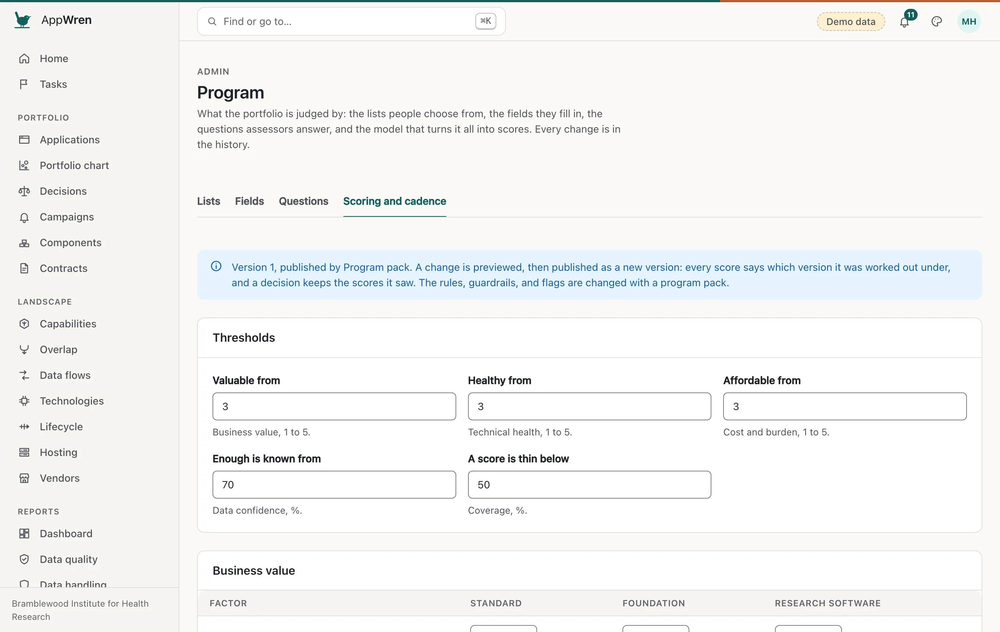
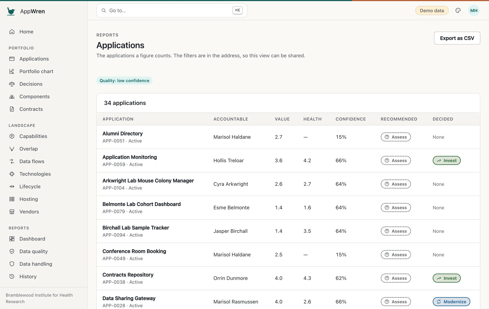
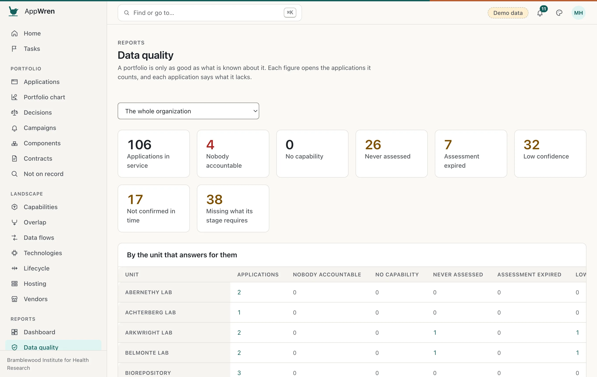
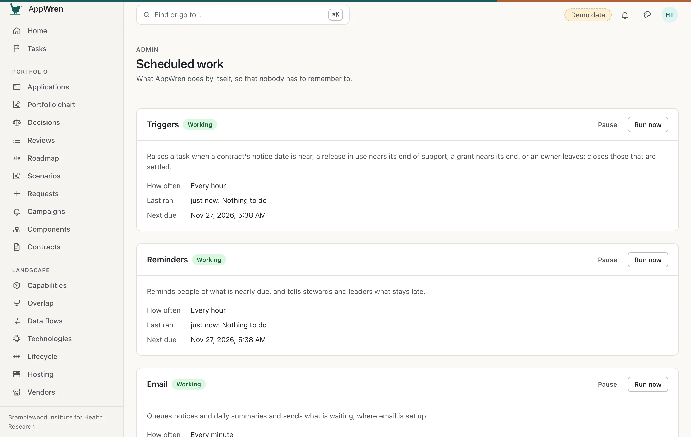
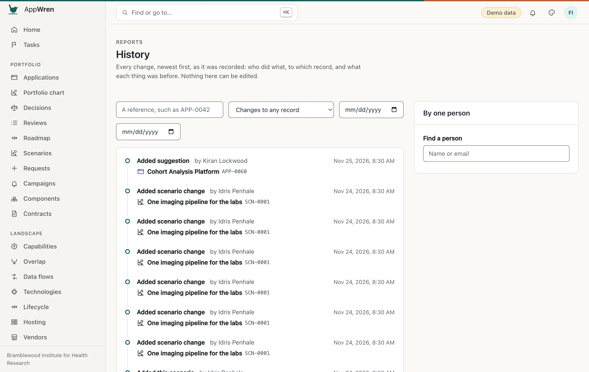

# Running the program

This guide is for the portfolio team and for administrators. It covers who may do what, who sees what, the program and how to shape it, upgrading, the dashboard and data quality, portfolio snapshots, scheduled work and email, the history, appearance, and backing up. How the portfolio keeps itself current (reminders, confirmations, campaigns, and tasks) is in [Keeping current](keeping-current.md).

## Two kinds of authority

AppWren keeps judgment and administration apart.

- **Managers** run the portfolio. They keep any application, record decisions, take snapshots, and shape the program: the vocabularies, the fields, the questions, and the scoring model.
- **Administrators** run the installation: accounts, units, sign-in, and appearance. Administration does not by itself let anyone keep applications or record decisions. An administrator who also does that work holds a second role, and the history shows which they acted under.

## Roles and scope

Everyone who can sign in is a **member**. The other six roles are given under **Admin → People**, or from the identity provider (see [Single sign-on](configuration.md#roles-from-the-provider)).

| Role | Scope | May |
|---|---|---|
| **Member** | Their own applications | Read the catalog, scores, recommendations, and decisions; keep, assess, and confirm the applications they are named on, and contest their scores |
| **Steward** | A unit and everything beneath it | Add, edit, import, assess, and confirm its applications, and hand on who is accountable; record their interfaces, deployments, and cost lines; add contracts; run campaigns over it |
| **Leader** | A unit and everything beneath it | See it, read its sensitive fields, cost lines, and contracts, and record decisions for its applications |
| **Architect** | The whole organization, or a unit | Keep capabilities, technologies and their releases, vendors, hosting platforms, and funding sources; import support dates; add, edit, import, and assess applications in scope; answer contests of their scores |
| **Manager** | The whole organization, or a unit | Everything a steward and an architect may do, in scope; record decisions; take portfolio snapshots; for the whole organization, shape the program and pass on what someone holds |
| **Auditor** | The whole organization | Read everything, including every sensitive field, contract, and restricted application, and the whole history; change nothing |
| **Admin** | The installation | Accounts, roles, units, sign-in, appearance, scheduled work and email; shape the program; pass on what someone holds |

"In scope" means the application's unit is the role's unit or beneath it. A person may hold several roles, each with its own unit.

Two rules hold whatever the role:

- **Nobody decides about their own application.** A manager or a leader who is an application's accountable owner cannot record a decision about it. Someone else decides. A team too small for anyone else to may turn this off on **Admin → Program → Decisions**; each decision an owner then records about their own application is marked as such, on the decision, in the history, and on the Decisions page.
- **Nobody types in a score.** Scores are worked out from the record and the answers, so nobody can raise their own.

## Who sees what

**The catalog is open.** Every application, component, interface, deployment, capability, technology, hosting platform, funding source, and vendor is visible to everyone signed in, with each application's scores, recommendation, and decision. A portfolio is useful in proportion to how many people can find what already exists: a researcher looking for an approved tool, an engineer checking who else runs a database, a team about to buy what another department already has.

Two things narrow that.

**Sensitive fields.** By default annual cost, the sign-in method, backup, and the last restore test are sensitive. They are visible to the people named on the application, to stewards, leaders, and architects in scope, and to managers, auditors, and administrators. To everyone else they are **withheld**: left out of the record, its list columns, its filters, and its exports, and out of the working of any score that would reveal them. The record says that something is withheld. A person who may not see a sensitive field may not filter or sort by it, nor send a value for it, and its changes appear in the history as withheld.

Scores are not sensitive: a member can see that an application is recommended for *Modernize* without seeing what it costs. On the portfolio chart, where bubble size would reveal cost, the bubbles are drawn the same size.

**Cost in detail.** What says more about cost than annual cost does is withheld with it:

- **Cost lines**, and the factors worked out from cost (cost per user, license use), are shown exactly where annual cost is.
- **A contract** is sensitive as a whole. It is seen by those who see every application's sensitive fields, by anyone who may see the sensitive fields of an application it covers, and by whoever made or owns it. Seen through one application, it does not name another the reader may not see.
- **Totals** of cost across applications, on the dashboard, the overlap page, and a funding source, are given whole or not at all: a total with a part hidden would give that part away.

**Restricted applications.** An application marked restricted, with its components, deployments, and interfaces, is known only to the people named on it, its creator, the stewards, leaders, architects, and managers whose scope includes it, auditors, and administrators. To everyone else it does not exist: not in lists, counts, charts, searches, pictures, or exports. An interface to a restricted application is hidden even from someone who keeps the application at its other end.

One function decides each of these, and every page, list, figure, and export calls it, so they always agree.

## Shape the program

The **program** is everything the portfolio team configures, kept in the database rather than in a file on the server:

| Part | What it holds |
|---|---|
| **Vocabularies** | Lifecycle stages, sourcing, purpose, pace, domains, tiers, hosting, sign-in methods, monitoring, backup, funding, data classes and their sensitivity, kinds of component, vendor, technology, platform, and unit, the radar's rings, the roles people hold on an application, link kinds, interface methods and frequencies, environments, cost categories, the states of a data agreement, other systems, and the dispositions |
| **Fields** | The organization's own fields, each in a section of the application's form |
| **What each stage requires** | The fields and records an application needs at each lifecycle stage |
| **Sensitive fields** | Which fields are withheld from people without a part in the application |
| **The definition** | What counts as an application, with examples of what does and does not |
| **The capability map** | The capabilities, in areas |
| **The question bank** | The questions, their five levels and the definition of each, and which applications each is asked of |
| **The scoring model** | Its profiles, their factors, weights, bands, and floors; the thresholds; the rules, guardrails, and flags; and the cadence: how long an assessment stays current and how often a record is confirmed, for each tier, what a stale record costs, when reminders go, and how far ahead tasks are raised |

The default program described in [The portfolio](the-portfolio.md) is a reasonable start for most organizations. [The engine](../spec/engine.md) sets out every factor, weight, band, rule, and flag in it.

### Shape it in the app

**Admin → Program** is for managers of the whole organization and for administrators. Every change is checked by the same rules a pack is, and kept in the history.

- **Lists.** Rename a value, describe it, put the values in another order, add one, or retire one. A value in use is retired rather than removed: records keep it, and it is no longer offered. The lists AppWren's own rules read by key, such as the lifecycle stages, the tiers, sourcing, and the dispositions, can be renamed, described, and reordered, but not added to or retired.
- **Fields.** Add a field of your own to the application's form, in the section it belongs to, or change its label, help, section, and choices; say which fields are sensitive. A field that holds values is never removed.
- **Questions.** Reword a question, its help, and its five levels. Publishing makes a new version of the question bank; every assessment keeps the version it answered.
- **Decisions.** Whether an application's accountable owner may record its decision, where they are also a manager or a leader over it. Off unless you turn it on; meant for a team too small for anyone else to decide.
- **Scoring and cadence.** Change the thresholds, the weights of every profile (each dimension's must add up to 100), and the cadence. Choose **See what it would change**: every application in service whose scores, confidence, recommendation, or flags would differ is listed, with what would move. Nothing changes until you choose **Publish**, which makes a new version of the model and changes exactly the applications listed.



The recommendation rules, guardrails, and flags, and which questions there are, name other parts of the model by key, so they are changed together with a pack.

### Or change it with a pack

Whoever runs the server can change the whole program as a file: export it, edit it, check it, and load it.

```bash
uv run appwren program export -o program.json
# edit program.json
uv run appwren program import program.json --dry-run
uv run appwren program import program.json
```

The whole pack is checked before anything is loaded, and nothing is loaded unless all of it can be: every vocabulary a field names, every fact a rule reads, every weight in a profile. `--dry-run` says what would change and changes nothing.

- A vocabulary value that is in use is **retired** rather than removed: records keep it, and it is no longer offered.
- Capabilities are only ever added. Rename or retire one in the app.
- Loading the same pack twice changes nothing.

A starter program can be loaded the same way over a program already in use, by its key: `uv run appwren program import starter-company --dry-run`. Its lists and settings replace yours, and its capabilities are added beside yours. See [Start from a program shaped like yours](getting-started.md#start-from-a-program-shaped-like-yours).

### Links to other systems

An application can carry its identifier in another system: a configuration item, a ticket queue, a repository. To have each shown as a link, give the system an address pattern in the `external_systems` vocabulary of the pack, with `{id}` where the identifier goes:

```json
{"key": "repository", "label": "Repository", "url": "https://code.example.org/{id}"}
```

A pattern must begin `https://`. A pack with any other pattern is refused.

#### How a record stands elsewhere

An application's record in another system of record (an AI-use review, a risk register entry, a security assessment) has a standing there: approved, open, closed. Where that system answers in JSON, give it a `standing_url`, and AppWren reads each linked record's standing every six hours and shows it beside the link:

```json
{"key": "governance_record", "label": "AI-use review",
 "url": "https://reviews.example.org/r/{id}",
 "standing_url": "https://reviews.example.org/api/r/{id}",
 "standing_field": "review.state", "key_env": "APPWREN_REVIEWS_TOKEN"}
```

`standing_field` says where in the answer to look, as a dotted path (`status` if left out). `key_env` names an environment variable holding a key, sent as a bearer token; it may not be one of the server's own variables. A change of standing is kept in the application's history, under *Standings*; a read that fails says why beside the link, and changes nothing else. Nothing is read until a system has a `standing_url`. Only an administrator sets `standing_url`, `standing_field`, and `key_env`, in a pack or in the app, since they make AppWren reach out to another system with a key.

### Versions

The question bank and the scoring model are **versioned**. A version in use is never changed: publishing in the app, or loading a pack that changes either, makes a new version, and the old one stays, marked superseded. Every assessment names the version of the questions it answered, and every snapshot names the version of the model it used, so a decision made last year still shows exactly what its maker saw.

Changing the scoring model changes every application's scores at once, the next time they are read. The preview in the app says which. Take a [portfolio snapshot](#portfolio-snapshots) first if you want a record of the portfolio as it was.

### What an upgrade does to the program

`uv run appwren db upgrade` adds whatever is new in the default program and never overwrites what you have shaped.

- **New vocabularies** arrive with their defaults. A vocabulary you have changed is left as you have it.
- **The scoring model.** Version 0.2.0 has a new default model: *cost and burden* is now annual cost 30, cost per user 15, license use 10, support effort 25, and change effort 20, and there are two new flags. If you are still running the previous default unchanged, the upgrade publishes the new one as a new version, and scores for cost and burden move. **If you have shaped your model, it is kept as it is.** To take the new factors, export the default from a fresh installation or copy them from [the engine](../spec/engine.md#cost-and-burden-cb) into your pack.
- **The cadence.** Version 0.3.0 adds to the default model how often records are confirmed and what a stale one costs, when reminders go, and how far ahead tasks are raised. A model nobody has changed since 0.1.0 or 0.2.0 is replaced by the new default. A model you have shaped is kept, and uses the same values until you set them on **Admin → Program**.
- **Signals and engineering maturity.** Version 0.4.0 adds to the default model the [signals](signals.md#signals-in-the-scores) sources supply (incidents, dependency alerts, code activity, engineering maturity, and support load), each counting only where a source supplies it, and the maturity levels beside the cadence. A model nobody has changed since an earlier release is replaced by the new default; no score moves until a source supplies something. A model you have shaped is kept, with no signals, and measures maturity by the default levels.
- **Stage gates and new lists.** Version 0.5.0 gates the lifecycle stages: an application cannot move to a later stage without what that stage requires. The gates are on after the upgrade too; switch them off on **Admin → Program → Decisions** to keep moving records as before. Two new lists arrive with their defaults: the kinds and the stages of an initiative.
- **Insight.** Version 0.6.0 adds leadership reports, scenarios, and the record as of a day. Nothing already recorded changes: as of a day reads the history you already have, back to the day AppWren was installed.
- **Adoption.** Version 0.7.0 adds API tokens and webhooks, both off until an administrator issues or registers one, and the brand kit, which keeps your appearance as it is until you change it. Nothing already recorded changes. A starter program is only for a new installation, or loaded by choice with `program import`.
- **Connected.** Version 0.8.0 adds the checkpoint, tokens of your own and suggestions, the tool server, the optional assistant, and standings elsewhere. Each is off, or does nothing, until someone uses it: the assistant until `[assistant]` is configured, and standings until a system is given a `standing_url`.
- **Who uses it.** Version 0.9.0 adds the kinds of people who use an application, as a new list with its defaults, and whether everyone in the organization does. Both are empty after the upgrade, and the units already recorded as using an application stay as they are. Nothing already recorded changes.
- **Nothing is stale on the day of an upgrade.** A record that has never been confirmed is due one period after the upgrade, not one period after it was added.
- Decisions already recorded keep the snapshot of the scores they were made against, whatever the model becomes.

## Read the dashboard

**Reports → Dashboard** shows the whole portfolio, or one unit and everything beneath it, or one domain.


- **The headline:** applications in service, how many have a decision, mismatches between decision and recommendation, reviews that are due, low confidence, and what runs on technology past or near its end of support.
- **Recommendations and decisions:** how many of each disposition, side by side, and how many have no decision yet.
- **Lifecycle and sourcing:** where the portfolio is in its life, and where its software comes from.
- **Flags:** how many applications carry each.
- **Confidence:** how many applications are known well enough to judge, in four bands.
- **What it costs a year, and what pays for it:** by kind of cost and by funding source, for those who see every application's cost. Others do not see these two cards.

**Every figure is a link** to the list it counts. A figure and its list are worked out by the same function from the same rows, so the number on the dashboard is always the length of the list it opens, and the list can be exported.



### Home

**Home** is each person's page of what is waiting on them: applications they are named on that have not been assessed, whose assessment has expired, or whose record is due to be confirmed; their tasks; what a campaign asks of them; flags on their applications; and what their records lack. A steward or manager also sees the applications in scope that nobody is accountable for; a leader or manager, the applications in their units waiting on a decision; a manager or architect, contests waiting for an answer. See [Keeping current](keeping-current.md).


### Data quality

**Reports → Data quality** shows, unit by unit, how complete the records are: applications with nobody accountable, no capability, no assessment, an expired assessment, low confidence, a record not confirmed in time, or something missing that their stage requires. Each figure opens its list. Choose a unit to see only it and the units beneath it.



A portfolio's recommendations are only as good as its records, and this page is how the work of keeping them is shared out: give each steward the row for their unit.

## Portfolio snapshots

A **portfolio snapshot** keeps every application's scores, recommendation, and working as they were on a day, under a name such as *2026 Q4*. Managers take them from **Portfolio → Decisions → Snapshots** with **Take a snapshot**, typically before each portfolio review and before changing the scoring model. The scheduler also takes one each month by itself, named for the month, so there is always a record of how the portfolio stood.

A snapshot reopens unchanged after the applications or the program have changed. Its digest is recorded in the history, so a snapshot altered afterwards is detectable.


Every decision also keeps a snapshot of the one application it was made about.

## Scheduled work and email

AppWren does some work by itself, so that nobody has to remember to. **Admin → Scheduled work** shows each job, when it last ran and what it did, and can run it now or pause it.

| Job | How often | What it does |
|---|---|---|
| **Triggers** | Every hour | Raises a task when a contract's notice date is near, a release nears its end of support, a grant nears its end, or an owner leaves; closes tasks whose cause is settled |
| **Reminders** | Every hour | Reminds people of what is nearly due or late, and tells stewards and leaders what stays late; closes campaign items whose thing has been done |
| **Email** | Every minute | Sends notices and daily summaries, where email is set up |
| **Standings elsewhere** | Every six hours | Reads how each linked record stands in another system of record, where the program gives that system a [standing address](#how-a-record-stands-elsewhere) |
| **Webhooks** | Every minute | Tells each [webhook](api.md#be-told-when-something-happens) an administrator has registered of what it asked for, signed, and tries a failed delivery again later |
| **Connectors** | Every 15 minutes | Runs each [connector](signals.md#connectors) an administrator has switched on, when it is due |
| **Monthly snapshot** | Every six hours | Takes the month's portfolio snapshot, once |
| **Housekeeping** | Every day | Removes records of old runs and sign-ins that were never finished |



Each job is claimed by one process before it runs, so several servers on one database, or `appwren jobs run` from a scheduled task, run it once between them. What is due is worked out from the database and the clock, so a restart catches up. To run the jobs from a scheduled task instead of inside the server, see [Configuration](configuration.md#scheduled-work).

**Email is optional.** Without it, notices are read under the bell and nothing is sent. With a mail server named in [the configuration file](configuration.md#email), each person chooses under **Your account** to have each notice as it happens, one summary a day, or none. Nothing written before email was set up is ever sent. The same page shows how email is doing and sends you a test message.

## The history

Every change to every record is written to an append-only history in the same transaction as the change: who, when, and each value before and after. Each event is hashed together with the one before it, and the database itself refuses updates and deletes on the history.

- Each record's **History** part shows its own events in plain words: what was changed, and what was added to it, such as an assessment, a decision, a cost line, or a capability it serves. Changes to a sensitive field, and to cost lines, are withheld from people who may not see them.
- **Reports → History** shows every change in one place, for managers, auditors, and administrators: narrowed to a person, a record, a kind of record, or a span of dates. It opens on changes to records; sign-ins, exports, and settings are one choice away.
- Exports are recorded, with who exported which list.
- `uv run appwren verify` recomputes the chain and reports the first event that has been altered, removed, or cut from the end.
- `uv run appwren doctor` checks that the database still refuses changes to the history.



Assessments and decisions are never edited. A new one supersedes the last, and all of them are kept.

## Appearance

**Admin → Appearance** makes the product yours, with a live preview:

- the product's name and your organization's name;
- a logo for light and for dark mode, and a tab icon;
- the default palette (Wren, Slate, or Garnet) and an accent color, which is adjusted for dark mode and refused if text on it could not be read;
- how scores are colored: an **ordinal** ramp in one hue from pale to deep, which keeps scores apart from the colors of flags, or a **signal** ramp from red through amber to green;
- an accent for dark mode, if the one worked out from your accent is not your brand's;
- a message and a picture on the sign-in page, up to five links at the foot of the sidebar and the sign-in page (your policy, your help desk), and a last line for every email, which also opens with your product's name in your accent;
- **your own words**: if your organization says *department* where AppWren says *unit*, or *solution* where it says *application*, the menu, page titles, and the kinds of record use your word. Words can be set for application, component, capability, technology, vendor, and unit.

When the look has to be exact (every color by day and after dark, the official logo files, the brand's typefaces) it is set in the configuration file instead: see [`[branding]`](configuration.md#branding). What the file sets is shown here, locked.

Each person chooses light, dark, or system mode and a palette for themselves, from the appearance button at the top right.


## Back up and recover

- Back up with `uv run appwren backup`, which writes the database and the data home's files to one file, on SQLite or PostgreSQL alike ([Back up and restore](configuration.md#back-up-and-restore)). Notices, reminders sent, and the email outbox are in the database; nothing about them needs backing up apart.
- `uv run appwren program export` keeps a copy of the program you have shaped.
- If nobody can sign in, [`appwren users`](cli.md#appwren-users) adds an administrator or resets a password from the server's own command line. Changes made there are recorded in the history as made at the command line.
