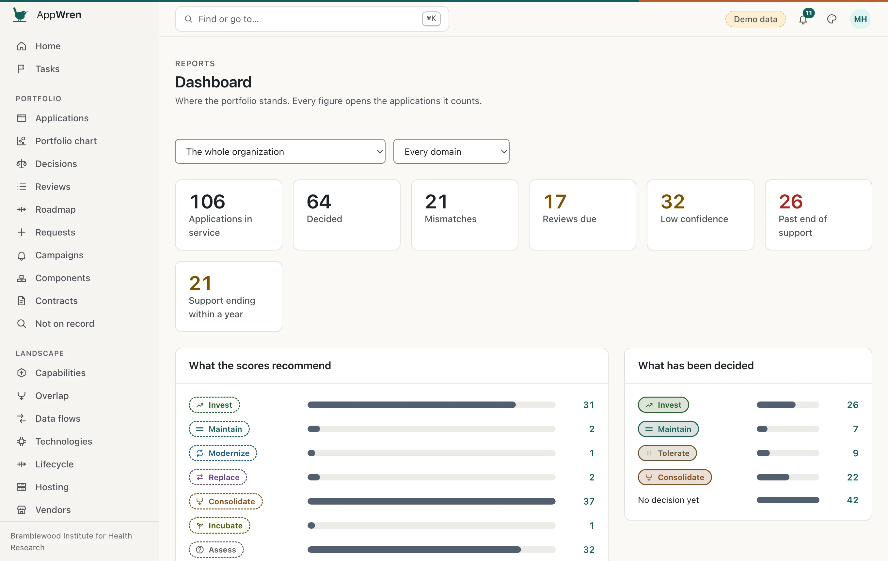
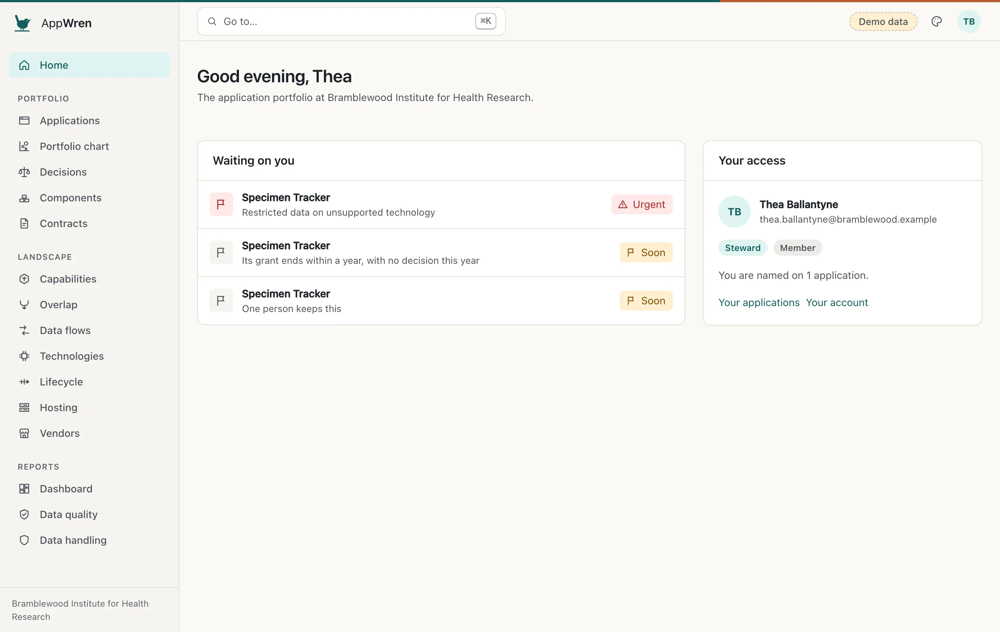
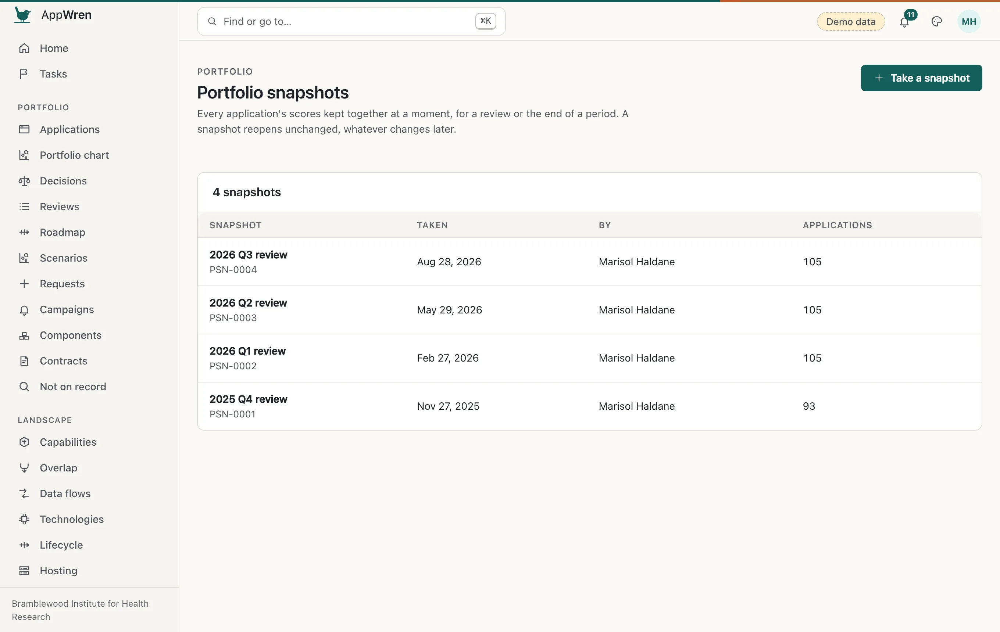
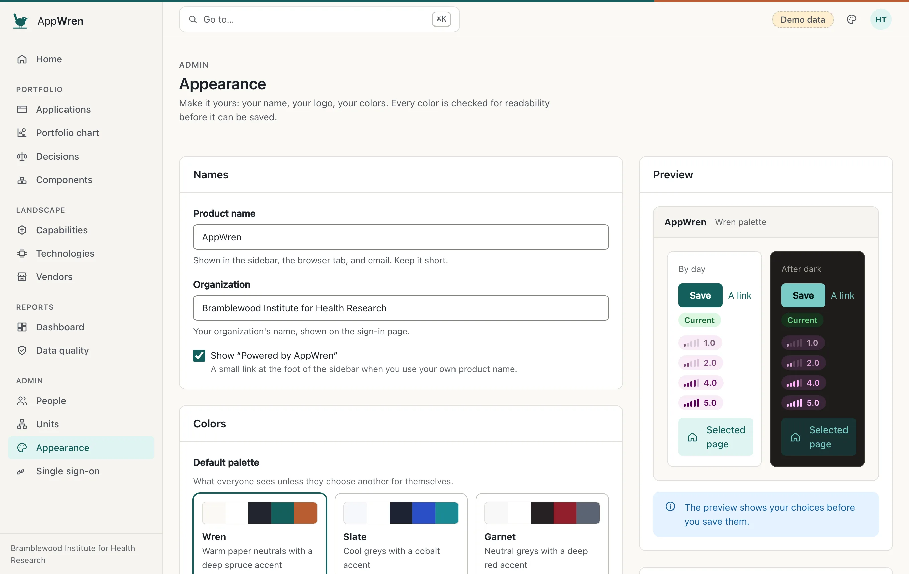

# Running the program

This guide is for the portfolio team and for administrators. It covers who may do what, who sees what, the program and how to change it, the dashboard and data quality, portfolio snapshots, the history, appearance, and backing up.

## Two kinds of authority

AppWren keeps judgment and administration apart.

- **Managers** run the portfolio. They keep any application, record decisions, take snapshots, and shape the program: the vocabularies, the fields, the questions, and the scoring model.
- **Administrators** run the installation: accounts, units, sign-in, and appearance. Administration does not by itself let anyone keep applications or record decisions. An administrator who also does that work holds a second role, and the history shows which they acted under.

## Roles and scope

Everyone who can sign in is a **member**. The other six roles are given under **Admin → People**, or from the identity provider (see [Single sign-on](configuration.md#roles-from-the-provider)).

| Role | Scope | May |
|---|---|---|
| **Member** | Their own applications | Read the catalog, scores, recommendations, and decisions; keep and assess the applications they are named on |
| **Steward** | A unit and everything beneath it | Add, edit, import, and assess its applications, and hand on who is accountable |
| **Leader** | A unit and everything beneath it | See it, read its sensitive fields, and record decisions for its applications |
| **Architect** | The whole organization, or a unit | Keep capabilities, technologies and their releases, and vendors; add, edit, import, and assess applications in scope |
| **Manager** | The whole organization, or a unit | Everything a steward and an architect may do, in scope; record decisions; take portfolio snapshots; shape the program |
| **Auditor** | The whole organization | Read everything, including every sensitive field and restricted application, and change nothing |
| **Admin** | The installation | Accounts, roles, units, sign-in, appearance |

"In scope" means the application's unit is the role's unit or beneath it. A person may hold several roles, each with its own unit.

Two rules hold whatever the role:

- **Nobody decides about their own application.** A manager or a leader who is an application's accountable owner cannot record a decision about it. Someone else decides.
- **Nobody types in a score.** Scores are worked out from the record and the answers, so nobody can raise their own.

## Who sees what

**The catalog is open.** Every application, component, capability, technology, and vendor is visible to everyone signed in, with its scores, recommendation, and decision. A portfolio is useful in proportion to how many people can find what already exists: a researcher looking for an approved tool, an engineer checking who else runs a database, a team about to buy what another department already has.

Two things narrow that.

**Sensitive fields.** By default annual cost, the sign-in method, backup, and the last restore test are sensitive. They are visible to the people named on the application, to stewards, leaders, and architects in scope, and to managers, auditors, and administrators. To everyone else they are **withheld**: left out of the record, its list columns, its filters, and its exports, and out of the working of any score that would reveal them. The record says that something is withheld. A person who may not see a sensitive field may not filter or sort by it, nor send a value for it, and its changes appear in the history as withheld.

Scores are not sensitive: a member can see that an application is recommended for *Modernize* without seeing what it costs. On the portfolio chart, where bubble size would reveal cost, the bubbles are drawn the same size.

**Restricted applications.** An application marked restricted, and its components, are known only to the people named on it, its creator, the stewards, leaders, architects, and managers whose scope includes it, auditors, and administrators. To everyone else it does not exist: not in lists, counts, charts, searches, or exports.

One function decides each of these, and every page, list, figure, and export calls it, so they always agree.

## Shape the program

The **program** is everything the portfolio team configures, kept in the database rather than in a file on the server:

| Part | What it holds |
|---|---|
| **Vocabularies** | Lifecycle stages, sourcing, purpose, pace, domains, tiers, hosting, sign-in methods, monitoring, backup, funding, data classes and their sensitivity, kinds of component, vendor, technology, and unit, the radar's rings, the roles people hold on an application, link kinds, other systems, and the dispositions |
| **Fields** | The organization's own fields, each in a section of the application's form |
| **What each stage requires** | The fields and records an application needs at each lifecycle stage |
| **Sensitive fields** | Which fields are withheld from people without a part in the application |
| **The definition** | What counts as an application, with examples of what does and does not |
| **The capability map** | The capabilities, in areas |
| **The question bank** | The questions, their five levels and the definition of each, and which applications each is asked of |
| **The scoring model** | Its profiles, their factors, weights, bands, and floors; the thresholds; the rules, guardrails, and flags; and how long an assessment stays current for each tier |

The default program described in [The portfolio](the-portfolio.md) is a reasonable start for most organizations. [The engine](../spec/engine.md) sets out every factor, weight, band, rule, and flag in it.

### Change the program with a pack

In this release the program is changed as a file, by whoever runs the server: export it, edit it, check it, and load it.

```bash
uv run appwren program export -o program.json
# edit program.json
uv run appwren program import program.json --dry-run
uv run appwren program import program.json
```

The whole pack is checked before anything is loaded, and nothing is loaded unless all of it can be: every vocabulary a field names, every fact a rule reads, every weight in a profile. `--dry-run` says what would change and changes nothing.

- A vocabulary value that is in use is **retired** rather than removed: records keep it, and it is no longer offered.
- Capabilities are only ever added. Rename or retire one in the app.
- Loading the same pack twice changes nothing.

### Versions

The question bank and the scoring model are **versioned**. A version in use is never changed: loading a pack that changes either publishes a new version, and the old one stays, marked superseded. Every assessment names the version of the questions it answered, and every snapshot names the version of the model it used, so a decision made last year still shows exactly what its maker saw.

Changing the scoring model changes every application's scores at once, the next time they are read. Take a [portfolio snapshot](#portfolio-snapshots) first if you want a record of the portfolio as it was.

Editing the program in the app arrives in a later release; see the [roadmap](../spec/roadmap.md).

## Read the dashboard

**Reports → Dashboard** shows the whole portfolio, or one unit and everything beneath it, or one domain.



- **The headline:** applications in service, how many have a decision, mismatches between decision and recommendation, reviews that are due, low confidence, and what runs on technology past or near its end of support.
- **Recommendations and decisions:** how many of each disposition, side by side, and how many have no decision yet.
- **Lifecycle and sourcing:** where the portfolio is in its life, and where its software comes from.
- **Flags:** how many applications carry each.
- **Confidence:** how many applications are known well enough to judge, in four bands.

**Every figure is a link** to the list it counts. A figure and its list are worked out by the same function from the same rows, so the number on the dashboard is always the length of the list it opens, and the list can be exported.


### Home

**Home** is each person's page of what is waiting on them: applications they are named on that have not been assessed or whose assessment has expired, flags on them, and what their records lack. A steward or manager also sees the applications in scope that nobody is accountable for; a leader or manager, the applications in their units waiting on a decision.



### Data quality

**Reports → Data quality** shows, unit by unit, how complete the records are: applications with nobody accountable, no capability, no assessment, an expired assessment, low confidence, or something missing that their stage requires. Each figure opens its list. Choose a unit to see only it and the units beneath it.


A portfolio's recommendations are only as good as its records, and this page is how the work of keeping them is shared out: give each steward the row for their unit.

## Portfolio snapshots

A **portfolio snapshot** keeps every application's scores, recommendation, and working as they were on a day, under a name such as *2026 Q4*. Managers take them from **Portfolio → Decisions → Snapshots** with **Take a snapshot**, typically before each portfolio review and before changing the scoring model.

A snapshot reopens unchanged after the applications or the program have changed. Its digest is recorded in the history, so a snapshot altered afterwards is detectable.



Every decision also keeps a snapshot of the one application it was made about.

## The history

Every change to every record is written to an append-only history in the same transaction as the change: who, when, and each value before and after. Each event is hashed together with the one before it, and the database itself refuses updates and deletes on the history.

- Each record's **History** part shows its own events in plain words. Changes to a sensitive field are shown as withheld to people who may not see it.
- Exports are recorded, with who exported which list.
- `uv run appwren verify` recomputes the chain and reports the first event that has been altered, removed, or cut from the end.
- `uv run appwren doctor` checks that the database still refuses changes to the history.

Assessments and decisions are never edited. A new one supersedes the last, and all of them are kept.

## Appearance

**Admin → Appearance** makes the product yours, with a live preview:

- the product's name and your organization's name;
- a logo for light and for dark mode, and a tab icon;
- the default palette (Wren, Slate, or Garnet) and an accent color, which is adjusted for dark mode and refused if text on it could not be read;
- how scores are colored: an **ordinal** ramp in one hue from pale to deep, which keeps scores apart from the colors of flags, or a **signal** ramp from red through amber to green.

Each person chooses light, dark, or system mode and a palette for themselves, from the appearance button at the top right.



## Back up and recover

- Back up the data home, and the database as well if you use PostgreSQL.
- `uv run appwren program export` keeps a copy of the program you have shaped.
- If nobody can sign in, [`appwren users`](cli.md#appwren-users) adds an administrator or resets a password from the server's own command line. Changes made there are recorded in the history as made at the command line.
