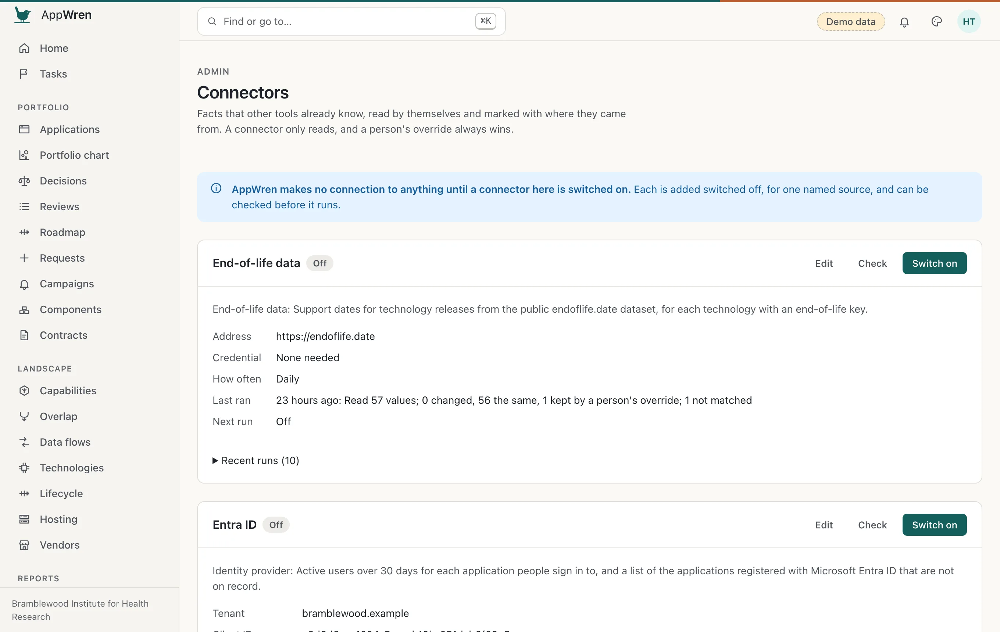
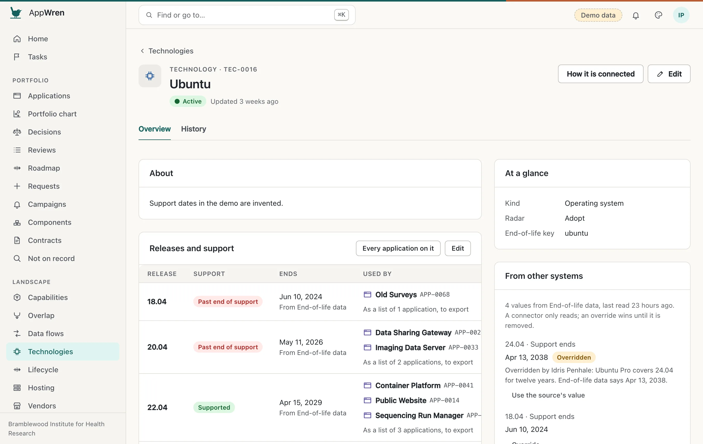
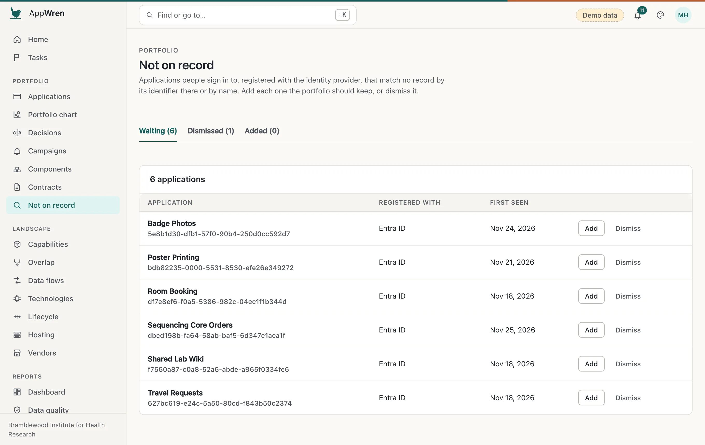
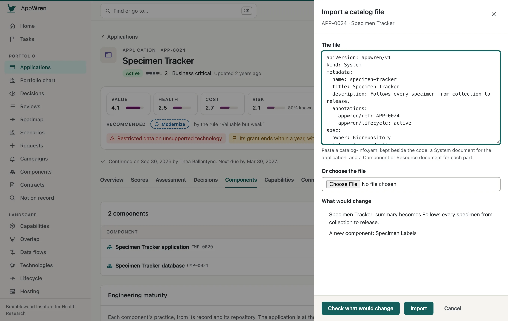

# Facts from other systems

This guide is for administrators who connect AppWren to the tools the organization already runs, and for everyone who reads what those tools supply. It covers connectors, values from other systems and overriding them, applications found that are not on record, push sources, catalog files, engineering maturity, and how all of this joins the scores.

## Nothing is connected until you connect it

A new installation makes no connection to anything. Each source is switched on separately, by an administrator, for one named source:

- A **connector** reads a source on a schedule: support dates, what the repositories know, who signs in.
- A **push source** is one of your own tools posting facts to AppWren with a key you issue.
- A **catalog file** is kept beside the code and imported into an application by a steward, architect, or manager who may edit it.

Whatever arrives is marked with where it came from, and never wins over a person: anyone who keeps the record can override it, with a reason. A value that fills a field of the record itself is recorded in its history like any other change; a fact that only informs a signal is kept on the record under *From other systems*, not in the history ([Values from other systems](#values-from-other-systems)).

## Connectors

**Admin → Connectors** lists the connectors set up, their recent runs, and the kinds of source AppWren can read. Choose **Add** beside a kind, name it, and give what is not secret (an address, an organization, a tenant). Its **Key**, a short name in lower-case letters, digits, and dashes, cannot be changed once it is made. **Run every so many hours** takes 1 to 168, and is 24 unless you change it. It is added switched off. Choose **Check** to see that it reaches its source, then **Switch on**.



**A credential never goes into AppWren.** A connector that needs one names the environment variable that holds it, such as `APPWREN_GITHUB_TOKEN`; the server reads it from its own environment when the connector runs. The page shows only whether it is set. That environment is fixed when the server starts, so after you set or change a credential, restart AppWren; until then a connector that is on says *It cannot run yet*. Give each credential the least access it needs, and only read access.

The variable may not be one of the server's own, since a connector sends its credential to the address you give it. Names beginning `APPWREN_SERVER_`, `APPWREN_DATABASE_`, `APPWREN_DATA_`, `APPWREN_SSO_`, `APPWREN_MAIL_`, `APPWREN_ADMIN_`, `APPWREN_TEST_`, `APPWREN_ASSISTANT_`, `PG`, or `AWS_` are refused, as are `APPWREN_CONFIG`, `DATABASE_URL`, and any variable the configuration names for a secret of its own.

| Kind | What it reads | Credential |
|---|---|---|
| **End-of-life data** | Support dates for technology releases, from the public endoflife.date dataset, for each technology with an end-of-life key | None. Only each technology's key is sent |
| **Source code hosting** | For each component whose repository is in one organization on GitHub or a GitHub Enterprise server: languages, when its code last changed, how many people changed it over 90 days, open dependency alerts by severity, and whether it has a README, tests, continuous integration, automated dependency updates, and a catalog file | A token that can only read the organization's repositories: their metadata, contents, and dependency alerts |
| **Identity provider** | For each application registered with Microsoft Entra ID: its active users over 30 days, from sign-ins; and those registered that are not on record | An application registration with the Microsoft Graph application permissions `Application.Read.All` and `AuditLog.Read.All`, consented by an administrator. Its client secret is the credential |

### End-of-life data

Give each technology its key in the dataset (on its record, **End-of-life key**: `python`, `nodejs`, `postgresql`). Each run follows the same rules as [support dates from a file](the-landscape.md#support-dates-from-a-file): releases are added and dates updated, nothing is removed, and a date the dataset does not give is left as it is. A key the dataset does not know is listed as not matched.

### Source code hosting

Give the host (`https://github.com`, or your GitHub Enterprise server) and the organization, as it appears in repository addresses. A component is read when its **Repository** is in that organization on that host. A repository the token cannot read is listed as not matched, and nothing else about it changes. Where the host will not say whether a repository has dependency alerts, its alerts are not known, which is not the same as none.

An application whose every repository was read gets its **maintainers** from the people who changed them over 90 days. From only some of them the count would be too low, so then its own number stands.

Each repository's people are counted from at most its 500 most recent commits over the 90 days, and its open dependency alerts from at most the first 100. **Code last changed** is the last push to any branch of the repository.

### The identity provider

Give the tenant (its ID or domain) and the client ID of the registration AppWren reads with. Each application registered there is matched to a record: by its identifier at the provider, kept on the record as its **Sign-in registration**, or else by its name or one of its aliases. A matched application's **users** become the people who signed in to it over the last 30 days. One that matches nothing is listed under [Not on record](#not-on-record).

Only applications people sign in to are read, not the provider's own services. A run reads at most about 6,000 registrations; a tenant with more fails the run, and nothing changes. For each matched application it reads at most 20,000 sign-ins over the 30 days; one with more keeps the users it had, and is listed as not matched. In a national cloud, give its **Sign-in address** and **Graph address**; elsewhere, leave them as they are.

### A run

Each connector that is on runs every 24 hours, or as often as you set, on the [scheduled work](running-the-program.md#scheduled-work-and-email); **Run now** runs it at once. A run reads everything first, under a time limit and a size limit on each answer, and only then writes, in one transaction. **A run that fails changes nothing**, and says why on the page. Each run records what it read, what changed, what stayed the same, what a person's override kept, and what it could not match. The page lists the latest 10 runs of each connector under **Recent runs**; only the last 50 of each are kept.

## Values from other systems

Where the record has a field of its own for a value (an application's users and maintainers, a release's dates and latest version), what a source supplies is written to that field, so every list, filter, export, and score reads one place, and the change is in the record's history. The other facts (incidents, support tickets, dependency alerts, languages, when the code last changed, how many people changed it, and the repository checks) fill no field of the record: they inform the signals and engineering maturity, and are not in the history. Each value is kept with its source and the time it was read. On the record, **From other systems** lists each one; a technology's releases table marks the dates that came from a source.



Someone who keeps the record can **Override** a value, saying why the source is wrong. The override wins until it is removed with **Use the source's value**; meanwhile the source's later readings wait beside it, and are shown. Changing such a field by hand on the record counts as an override too. Who overrode a value, when, and why is kept with it under **From other systems**. Where the value fills a field of the record, the override is in its history too, with the reason; the override of a fact that fills no field is not.


## Not on record

**Portfolio → Not on record** lists the applications registered with the identity provider that match no record, for stewards, architects, and managers. Each is listed once.

- **Add** makes an application record named for it, in a unit you choose, with the provider's identifier kept on it. The next run matches it and gives it its users.
- **Dismiss** says why it is not kept on record, such as a test registration. A dismissed one can be listed again.

One that someone records by hand is matched by the next run and leaves the list; one the provider no longer lists, that nobody decided about, goes. A connector never makes a record by itself.



## Push sources

For a tool AppWren has no connector for, such as the service desk or monitoring, an administrator issues a **push key** on the **Push keys** card of **Admin → Connectors**, with **Issue a key**. The key is shown once and kept only as a hash; if it is lost, revoke it and issue another. The tool posts facts with it:

```bash
curl -X POST https://appwren.example.org/api/v1/facts \
  -H "Authorization: Bearer $APPWREN_PUSH_KEY" -H "Content-Type: application/json" \
  -d '{"facts": [
        {"record": "APP-0042", "field": "incidents_90d", "value": 3, "observed_at": "2026-11-20T09:00:00Z"},
        {"record": "APP-0042", "field": "tickets_90d", "value": 27}
      ]}'
```

Each fact names a record by its reference, a field, a value, and optionally when it was observed (with its time zone; now, if not given; never in the future) and, for a technology, the `release`. Any field a connector fills may be posted, and two only pushes fill:

| Field | Of | What it is |
|---|---|---|
| `incidents_90d` | An application | Incidents over the last 90 days |
| `tickets_90d` | An application | Support tickets over the last 90 days |

A batch of up to 1,000 facts is checked whole before anything is written: one bad fact and nothing lands, and the answer names each problem by its place in the list. Otherwise the answer counts the facts accepted, and how many of them changed a value, changed nothing, or were kept back by a person's override. The facts are shown as from the key's name. **A key posts facts and does nothing else**: it reads nothing and no other route accepts it, and a person signed in cannot post facts.

## Catalog files

An application and its components can be described in a `catalog-info.yaml` kept beside their code. On an application's **Components** part, **Export a catalog file** writes one; **Import one** reads one back, showing first what would change. **Import one** is shown to the stewards, architects, and managers who may edit the application.



The file is at most 1 MB and holds 1 to 200 documents, each with `kind`, `metadata`, and `spec`. A `System` describes the application: its `description`, `tags`, `lifecycle` (`production`, `experimental`, `deprecated`, or a stage's key in an `appwren/lifecycle` annotation, which wins), and links to its documentation and home page. Its `tags` replace the application's tags: a tag the file leaves out is removed. Each `Component` or `Resource` describes one of its parts: its `type` (`service`, `website`, `library`, `database`, and so on, or a kind of component's key in an `appwren/kind` annotation, which wins), its description, and its repository, from a `github.com/project-slug` or `gitlab.com/project-slug` annotation or a link of type `source`. A part is matched by the reference AppWren wrote into it, or by name; one that matches none is added. Owners are not taken from a file: people are named in AppWren.

Only what the file says is changed, and no part is removed, so the same file twice changes nothing the second time. Files are read with a safe loader. An exported file carries AppWren's references, so it matches the same records when imported again.

## Engineering maturity

Each component's engineering practice is measured by checks, each from a record's field or a fact a source supplied:

| Level | Adds these checks | Read from |
|---|---|---|
| **Bronze** | Monitoring, backups, documentation | The application's record; documentation is its documentation address, or a README in the repository |
| **Silver** | Tests, continuous integration | The repository |
| **Gold** | Automated dependency updates, no open critical dependency alert | The repository |

A component reaches a level when every check of that level and those below it is met. A check about code does not apply to a part that is not code, such as a database; code with no repository recorded cannot pass it. An application is at the level of its **least mature component**. Only an application that is built here, research software, or low-code, or that has a component with a repository recorded, is measured: a bought product's engineering is its vendor's. One with no active component has nothing to measure. Either way it is **Not measured**.

A component's page shows its level, each check and why, and what it needs for the next level; an application's **Components** part shows each component's. The applications list filters by level, and **Reports → Engineering maturity** counts the applications at each level under each unit, each count a link to the list behind it.


The levels and their checks are part of the scoring model, beside the cadence, and can be changed [with a pack](running-the-program.md#or-change-it-with-a-pack).

## Signals in the scores

What sources supply joins the scores as **signals**, each a factor in the dimension it informs:

| Signal | Dimension | Weight | From |
|---|---|---|---|
| Incidents over 90 days | Technical health | 10 | A push source |
| Open critical and high dependency alerts | Technical health | 10 | Source code hosting |
| Days since its code changed (built here or research software) | Technical health | 5 | Source code hosting |
| Engineering maturity | Technical health | 10 | Its checks, where a repository was read |
| Support tickets over 90 days | Cost and burden | 10 | A push source |

**A signal counts only where a source supplies it.** Elsewhere it does not apply, which is not the same as unknown: it neither lowers confidence nor moves the score, so an application with no source scores exactly as before. A dimension's other factors still add up to 100; a signal comes on top. The working names where each signal came from, and where a field such as users or maintainers was filled by a source.


A signal's weight is set on **Admin → Program → Scoring and cadence** like any other factor's, and the weights there add up to 100 without the signals. An installation still running an earlier default scoring model unchanged gets the signals and the maturity levels on upgrade. One that shaped its own model keeps it as it is.

## Next

- [The API](api.md): the routes for connectors, push keys, facts, catalog files, and maturity.
- [Running the program](running-the-program.md): the scoring model, and scheduled work.
