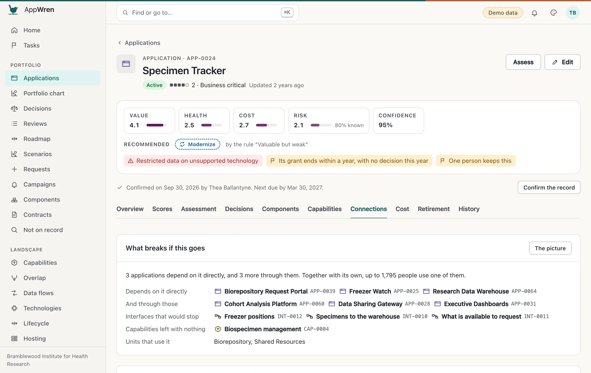
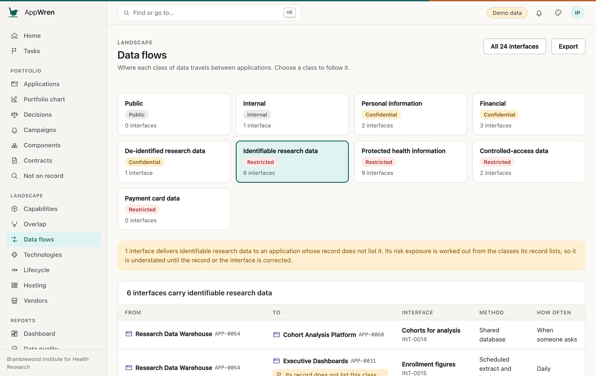
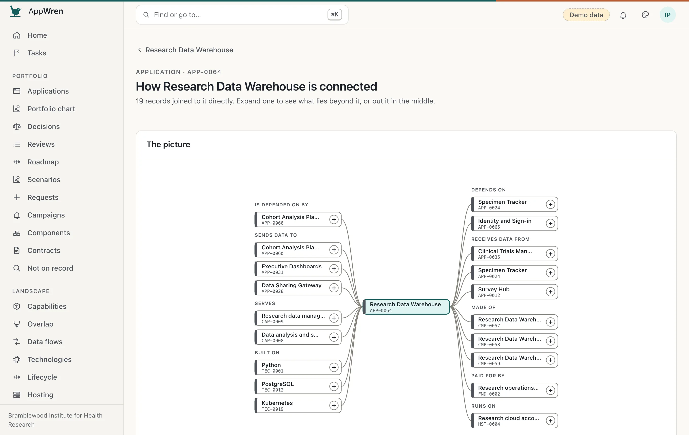
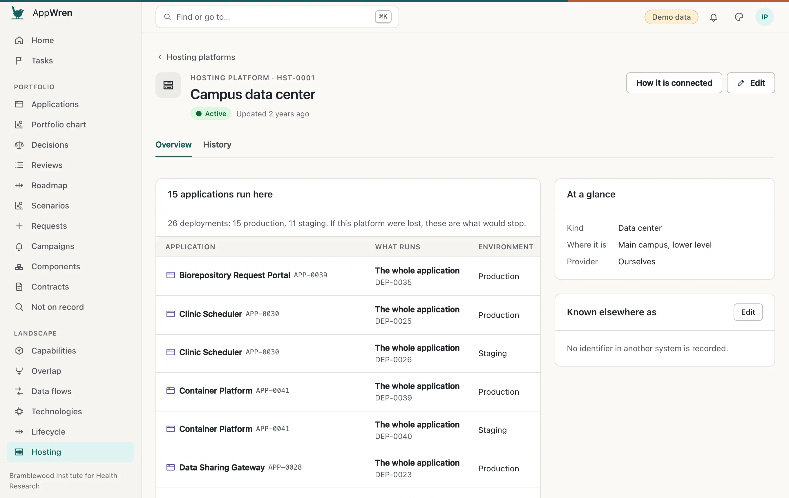
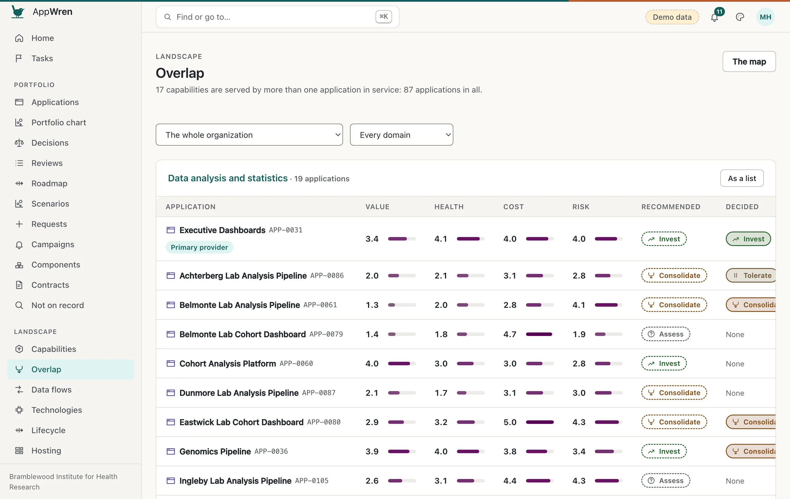
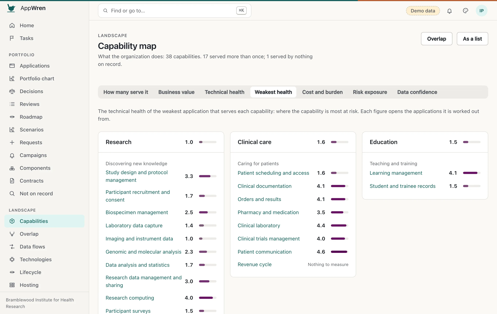
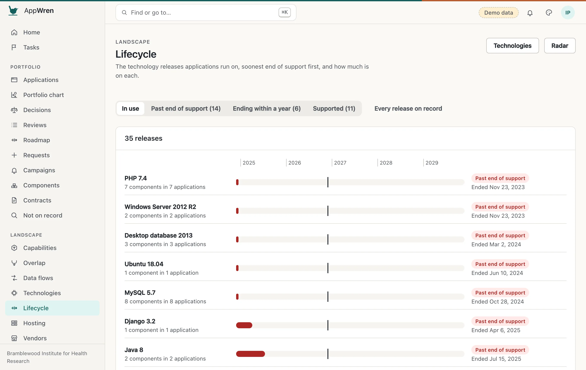
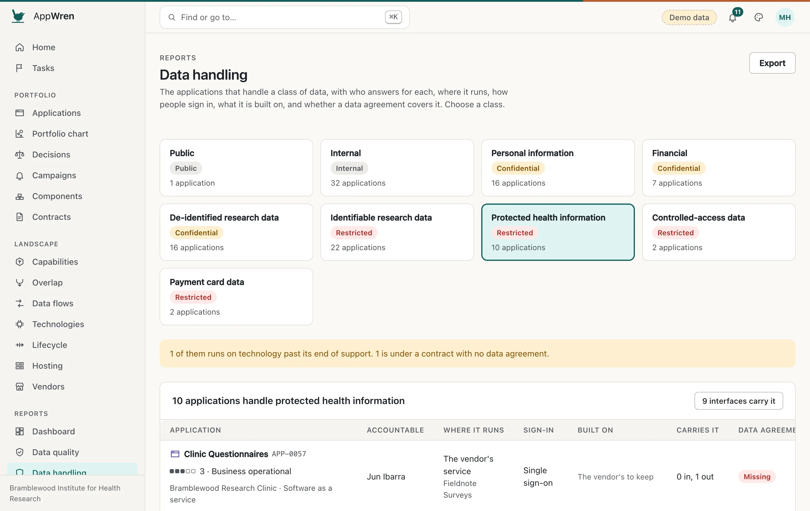

# The landscape

This guide is for architects, the portfolio team, and anyone who needs to see an application in its surroundings: what it exchanges with others and what data passes, what depends on it, where it runs, what else does the same job, and what it is built on that is falling out of support. [The portfolio](the-portfolio.md) covers one application's record; this guide covers what joins them.

## Interfaces

An **interface** is data passing from one application to another. It is a record of its own, with a reference such as `INT-0015`, and says:

| | |
|---|---|
| **From** and **To** | The application the data comes from, and the one it goes to. Two different applications |
| **Method** | An API call, a file transfer, a scheduled extract and load, a shared database, messages or events, an embedded page, or by hand |
| **How often** | As it happens, hourly, daily, weekly, monthly, or when someone asks |
| **Data it carries** | The classes of data that pass, from the same list an application's record uses |
| **Owner** | Who to ask about it |

To record one, open either application, choose **Connections**, and then **It sends data** or **It receives data**. The people who keep either application keep the interface.



An interface is seen by whoever may see both of its applications. If either is restricted, the interface is hidden with it, even from someone who keeps the other end.

### A consumer depends on its source

An application that receives data depends on the one that sends it, just as a recorded *depends on* link says. Both count, once each, toward the source's **dependents**, which is part of its business value. Recording what a system feeds can therefore raise its score, and its working says how many depend on it.

### Follow a class of data

**Landscape → Data flows** shows where each class of data travels. Choose a class to see every interface that carries it and every application that holds it.



Where an interface delivers a class that the receiving application's record does not list, the flow is marked. Either the interface carries less than was recorded, or the application's record needs the class added. AppWren cannot know which, and changes neither; but until somebody does, that application's risk exposure is understated, because it is worked out from the classes its record lists.

## How a record is connected

Every application, component, capability, technology, vendor, interface, hosting platform, contract, and funding source has a picture of what it is joined to. Open it with **How it is connected** on the record, or **The picture** on an application's Connections.



- The record is in the middle, with its neighbors in groups: what it depends on and what depends on it, where its data goes and comes from, the capabilities it serves, its components, what they are built on, its vendor, where it runs, and the contracts and funding behind it.
- The **+** on a neighbor shows what lies beyond it. Choosing a neighbor puts it in the middle.
- **Tab** moves through the records; **Enter** on a record puts it in the middle, and on its button opens it.
- A list beside the picture says everything the picture does, and is drawn from the same answer.
- Records you may not see are counted, never named.

### What breaks if this goes

An application's **Connections** part begins with what would be touched if it stopped:

- what depends on it directly, and what depends on those in turn;
- the interfaces that would stop;
- the capabilities left with no application at all, and those that would lose their primary provider;
- who uses it: everyone in the organization, or the units and the kinds of people who do, and up to how many people use it or anything that depends on it (the same person may use several, so this is an upper bound);
- what its record says must outlive it: that active studies depend on it, that it is a system of record, that its data must be kept.

Read it before recommending a retirement. A *Retire* for the only provider of a capability is already turned into *Replace* by the engine; this page shows what else is at stake.

## Where it runs

**Landscape → Hosting** holds the **hosting platforms** things run on: data centers, cloud accounts, compute clusters, hosting providers, a vendor's own service, or people's own computers. Architects and managers keep them, each with its kind, its provider, and where it is.

A **deployment** says that an application, or one of its components, runs in an environment (production, staging, test, development, or disaster recovery) on a platform, optionally at an address. To record one, open the application, choose **Components**, then **Say where it runs**. Leave the name empty and it is named for what runs and where: *Tracker API, production*.

A platform's page lists everything on it, by environment: what would stop if the platform were lost.



What a vendor hosts has no deployment of yours: the application's *Hosting* field says so.

## Overlap

**Landscape → Overlap** lists every capability served by more than one application in service, with those applications side by side: their four scores, the recommendation, the decision on record, how many people use each, and what each costs where you may see it.



- The **primary provider** is named first. An application that serves a capability whose primary is another, and is worth less, is recommended for *Consolidate*.
- Where no primary is named, none of them is recommended for consolidation: name one on its **Capabilities** part.
- **As a list** opens the same applications in the portfolio list, where they can be exported.
- A total of cost is shown only when you may see the cost of every application in it.

### The capability map, measured

**Landscape → Capabilities** shows the map. Above it, choose what to measure each capability by:

| Measure | Shows |
|---|---|
| How many serve it | The number of applications in service: none, one, or an overlap |
| Business value, Technical health, Cost and burden, Risk exposure | The average over the applications that serve it |
| Weakest health | The technical health of the weakest application that serves it: a capability is as exposed as the worst thing it rests on |
| Data confidence | How much is known about the applications that serve it |



Each figure is a number with the score's own bar, and opens the applications it was worked out from. A broader capability is measured over every application beneath it, each counted once.

## What falls out of support

### Lifecycle

**Landscape → Lifecycle** shows the technology releases applications run on, soonest end of support first. Each is a bar from the release's first day to the end of its support, with today marked, and beside it the state, the date, and how many components in how many applications are on it.



Narrow it to what is past its end of support, ending within a year, or supported. **Every release on record** adds the releases nothing runs on. Applications with a planned retirement are listed beneath.

The counts here are the same as on each technology's page, which names the applications.

### Which applications run on a release

To answer "which applications run on .NET 6?", open the technology and, beside the release, choose **As a list**. The applications list opens narrowed to it, and **Export** gives the same rows as a spreadsheet. **Every application on it** does the same for every release, and the card of components that name no release has its own list. An application is on a release when any of its components is.

The same narrowing works in the address and through the API: `technology` (a reference), with `release` (a release's cycle, or `none`), or `version` (an exact version as recorded, such as `6.0.25`, or its start, such as `6.0`). The components list takes them too. Each list is cut to what the reader may see, like any other.

### Radar

**Radar**, reached from Technologies or Lifecycle, shows the technologies in use by the organization's view of each for new work: *Adopt*, *Trial*, *Assess*, or *Hold*, each with its kind and how many components run on it. Technologies that are in use and that nobody has placed are listed apart: someone should say whether new work may use them.

An application all of whose technologies are supported scores better for technology currency if every one is *Adopt*, and worse if any is on *Hold*.

### Support dates from a file

Support dates can be typed on each technology's page, brought in from a file, or read by the [end-of-life connector](signals.md#end-of-life-data) once an administrator switches it on, so that nobody types them. For a file, AppWren fetches nothing: you bring it.

1. On each technology, set its **End-of-life key**: the name the file knows it by, such as `python` or `postgresql`.
2. Get a JSON file of end-of-life data. It is one object: each product's key, with its list of releases.

   ```json
   {
     "python": [
       {"cycle": "3.13", "releaseDate": "2024-10-07", "eol": "2029-10-31", "latest": "3.13.1"},
       {"cycle": "3.9", "releaseDate": "2020-10-05", "eol": "2025-10-31"}
     ]
   }
   ```

   `eol` is the day support ends; `extendedSupport`, where it is a date, is the day extended support ends.
3. On **Landscape → Technologies**, choose **Import support dates**, choose the file, and **Check the file**. AppWren says how many technologies matched, which releases would be added, and every date that would change, from what to what.
4. Choose **Import**.

Or from the server's command line:

```bash
uv run appwren technologies import-eol eol.json --dry-run
uv run appwren technologies import-eol eol.json
```

The import adds releases and updates dates. It removes nothing, leaves alone any date the file does not give, and changes nothing the second time it is run. Each change is in the technology's history under whoever ran it.

## Who handles a class of data

**Reports → Data handling** lists the applications in service that handle a chosen class of data, with what an analysis of risk asks about each:



| Column | What it says |
|---|---|
| Application | Its tier, unit, and sourcing |
| Accountable | Who answers for it, or that nobody does |
| Where it runs | Its platforms in production, or its hosting, and its vendor |
| Sign-in | How people sign in to it |
| Built on | The worst support state among what its components run on, and the releases |
| Carries it | How many interfaces carry the class into it and out of it |
| Data agreement | Whether a contract that covers it has one in place, needs none, or lacks one |

**Export** gives the same rows as a spreadsheet. Sign-in and the data agreement are withheld from readers who could not see them on the application's own record. See [Who sees what](running-the-program.md#who-sees-what).

## Next

- For what an application costs and the contracts behind it, read [Cost and contracts](the-portfolio.md#cost-and-contracts).
- For who may see and keep each of these, read [Running the program](running-the-program.md#roles-and-scope).
