# The portfolio

This guide is for everyone who keeps, assesses, or reads the record of an application: the people named on applications, the stewards of units, architects, leaders, and the portfolio team. It covers what an application is, the record and what each stage of its life requires, components and what they are built on, capabilities, assessment, the scores and the working behind them, recommendations, flags, decisions, cost and contracts, and import and export. What joins applications to one another is in [The landscape](the-landscape.md).

## What counts as an application

An application is software, or a service built from software, that people name, use for a purpose, and could decide to keep, change, or retire as one thing.

| An application | Not an application |
|---|---|
| The grants management system | A server or a database on its own: record it as a **component** of what it serves |
| The learning management system | A report or a module of a larger system: a component of that system |
| A lab's sample tracker, used by three labs | A spreadsheet one person keeps for themselves |
| The research data warehouse | A programming language or a platform: a **technology** |

Holding to one definition is what lets the portfolio compare like with like. The definition is part of the program, and the form for a new application shows it.

## The record

**Portfolio → Applications** lists every application you may see, with its scores, its recommendation, and the decision on record. Filter it by lifecycle stage, sourcing, tier, domain, or unit; search by name or reference; and choose **Mine** for those you are named on.

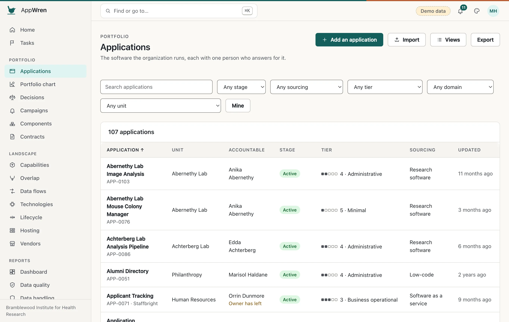

Each application has a permanent reference, such as `APP-0042`, that never changes or is reused. Its page has nine parts:

| Part | What it holds |
|---|---|
| **Overview** | The scores, the recommendation and the decision, the people named on it, what its record still needs, and every field |
| **Scores** | Each dimension's working, the rule behind the recommendation, and what would raise confidence |
| **Assessment** | The latest answers, who gave them and when, and every assessment before |
| **Decisions** | The decision on record, with the scores it was made against, and every decision before it |
| **Components** | Its parts, the technologies each is built on, and where it runs |
| **Capabilities** | What it does for the organization, and who else does it |
| **Connections** | What would break if it went, what it sends and receives, and what it depends on. See [The landscape](the-landscape.md) |
| **Cost** | What it costs a year, line by line, and the contracts that cover it |
| **History** | Every change to it, by whom and when |

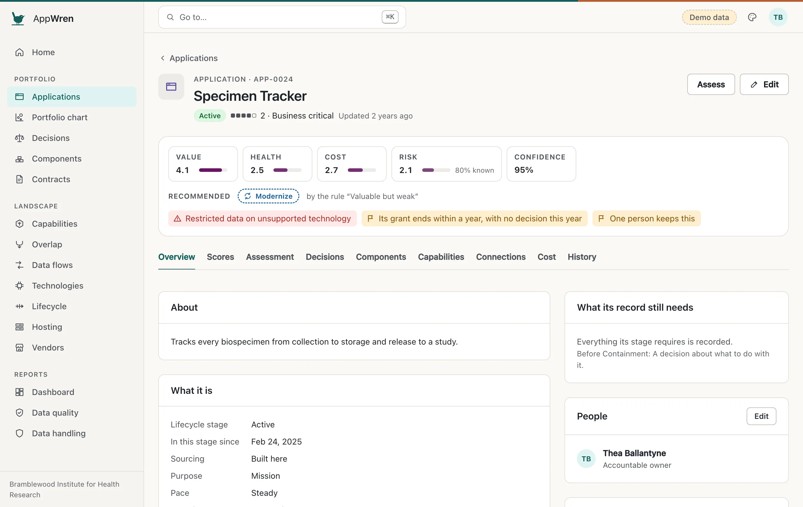

### The fields

Besides its name, its summary, and its unit, an application's fields come in sections:

| Section | Fields |
|---|---|
| **What it is** | Lifecycle stage and since when; sourcing (SaaS, Commercial run here, Built here, Open source run here, Low-code, Research software, or Vendor-hosted custom); purpose (Mission, Operations, Insight, Foundation); pace (Steady, Evolving, Experimental); domain; criticality tier, from 1 (mission critical) to 5 (minimal); other names it goes by |
| **Where it comes from** | Vendor, product, edition or version, hosting, its address, and its documentation |
| **Who uses it** | About how many people use it, and whether people outside the organization do |
| **Who supports it** | How many people can maintain it, and the team that supports it |
| **Security and data** | How people sign in, and the classes of data it handles, from public to controlled-access |
| **How it is run** | Monitoring, backup, and the date of the last restore test |
| **Cost and funding** | Annual cost, all in; funding (Operating, Grant, Chargeback, Capital, Mixed); and the grant or award and when it ends |
| **Research** | Whether active studies depend on it, whether it is the system of record for regulated information, and whether its data must be kept after it is retired |
| **Its life** | When it went into use, when it is planned to retire, and what replaced it |

An organization adds its own fields in the program, in any of these sections; the default program adds three (ethics protocols, a data management plan, and accessibility). A record never holds the data an application holds: no patient, participant, or other protected data goes in a description or a note.

Some fields are **sensitive**: by default, annual cost, the sign-in method, backup, and the last restore test. People who may not see them find them marked as withheld. See [Who sees what](running-the-program.md#who-sees-what).

### People named on it

Every application has exactly one **accountable owner**, the person who answers for it. Whoever adds an application is accountable for it until they hand it on. Others may be named as business owner, technical owner, product manager, support contact, data steward, security contact, or executive sponsor, and as many of each as it needs.

Anyone named on an application may change who else is named. Only the accountable owner, the steward of its unit, or an architect or manager whose scope includes it may hand on the accountability. An application whose accountable owner has left is flagged **No accountable owner** and listed on its steward's home page.

### What each stage requires

An application moves through eight lifecycle stages: Proposed, Evaluating, Phase-in, Active, Containment, Phase-out, Retired, and Archived. Each stage asks more of the record than the one before, and the record says what is still missing, now and before the next stage:

| Stage | Requires, in addition to the stages before |
|---|---|
| Proposed | A summary, its sourcing, and the capabilities it serves |
| Evaluating | An accountable owner, its purpose, and its data classes |
| Phase-in | Its tier, hosting, supporting unit, annual cost, and funding |
| Active | How people sign in, monitoring, backup, users, maintainers, domain, pace, what its components are built on, and a current assessment |
| Containment | A decision about what to do with it |
| Phase-out | When it is planned to retire |

**What a stage requires is a gate.** An application cannot move to a later stage without what that stage, and those before it, require: the editor, the API, an import, and a catalog file are refused, and say what is missing. Moving back, and retiring, need nothing, so a retirement is never stopped for want of a full record. What a record lacks for its stage is also shown on its page and counted on [Data quality](running-the-program.md#data-quality). The portfolio team can switch the gates off on **Admin → Program → Decisions**; the record then still shows what it lacks, but may move anyway.

### Links and other systems

An application can be recorded as **depending on** another, as **part of** another, or as **replacing** another. Data passing between two applications is recorded as an [interface](the-landscape.md#interfaces). How many active applications depend on one, by a link or by receiving its data, is part of its business value.

It can also carry its references in other systems: a configuration item, a ticket queue, a repository, its sign-in registration, a contract number, or a governance record. Search finds an application by any of them, and each is shown as a link where the program gives its system an [address pattern](running-the-program.md#links-to-other-systems).

### Restricted applications

An application can be marked **restricted**, which hides even its existence from everyone except the people named on it, the stewards and leaders of its unit, architects and managers whose scope includes it, auditors, and administrators. Use it sparingly: a portfolio is useful in proportion to how many people can find what already exists.

## Components and what they are built on

**Portfolio → Components** lists the parts of applications: services, web front ends, databases, batch jobs, integrations, reports, modules, libraries, mobile apps, analysis pipelines, and infrastructure. A component belongs to one application and takes its unit and its visibility from it.

Each component records the **technologies** it is built on, and which release of each. That is what makes *technology currency* a fact rather than an opinion: AppWren knows when each release reaches end of support.

**Landscape → Technologies** holds the languages, frameworks, runtimes, databases, operating systems, platforms, and products the organization uses, each with its releases and their support dates, its vendor, and where it stands in the organization's **technology radar**: Adopt, Trial, Assess, or Hold. A technology's page lists every component, and so every application, on each release, and says which releases are supported, ending within a year, on extended support, or ended.

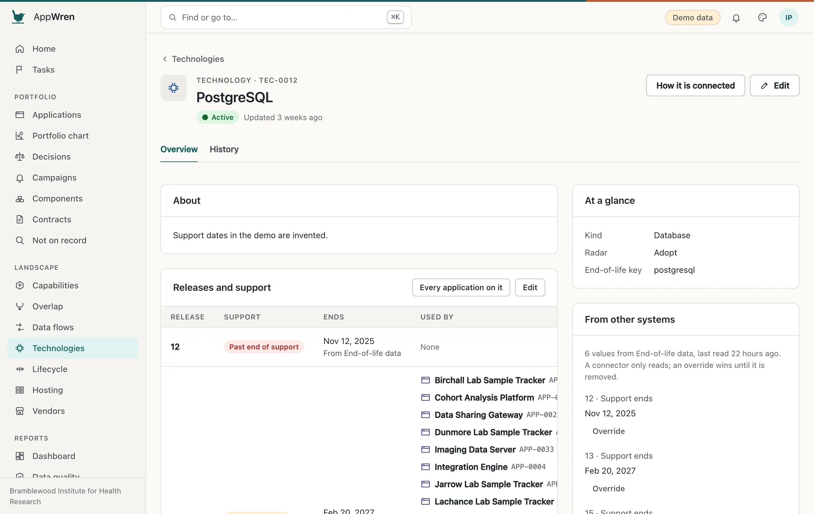

Architects and managers keep technologies, their releases, and **vendors**. A vendor's page lists what the organization has from it.

A SaaS product with no components recorded is not judged on technology currency: that is the vendor's to keep.

The Components part also says **where it runs**: each deployment of the application, or of one of its components, in an environment on a [hosting platform](the-landscape.md#where-it-runs).

## Capabilities

A capability is something the organization does, such as *Biospecimen tracking* or *Participant surveys*, named for what it does, not for the software that does it. **Landscape → Capabilities** shows the capability map: the default program's 43 capabilities in five areas (Research, Clinical care, Education, Administration, and Information technology), each with how many applications serve it.

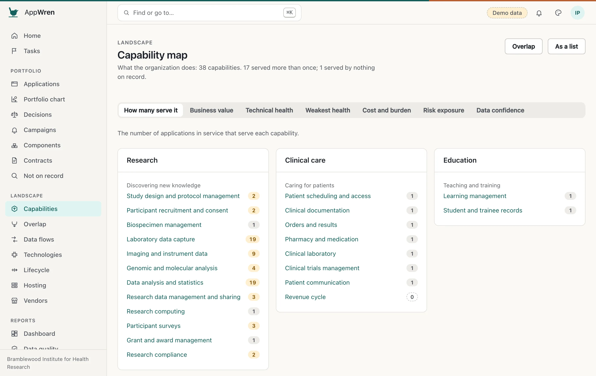

An application's **Capabilities** part says which it serves. Where several serve one, one of them can be named its **primary** provider. This is how AppWren finds overlap: an application that serves a capability whose primary is another, is primary for none, and is worth less than that primary, is recommended for **Consolidate** into it.

Architects and managers add and arrange capabilities.

## Assessment

An assessment is a set of answers to the question bank, given by a named person on a date. The questions are kept for judgment; anything that can be measured is a field instead.

| Dimension | Questions |
|---|---|
| Business value | How closely does it support what the organization is trying to achieve? How well does it do what its users need today? Will the organization still need what it does in three years? |
| Technical health | How well does it meet the service its users expect? How easy is it to change, upgrade, and keep current? How confident are we in the vendor and the product's future? (asked only of vendor-sourced applications) |
| Cost and burden | How much effort does it take to keep running? How much effort does it take to change or upgrade? |
| Risk exposure | Are there known gaps against the rules that apply to it, such as open audit findings or a missing agreement? |

Every answer is a level from 1 to 5, each with a written definition shown as you choose, so that a 4 means the same thing in every department. *Don't know* is always an answer, and counts as unknown rather than as a low score. Each answer can carry a note.

To assess an application, open it and choose **Assess**. The scores beside the form change as you answer: they come from the server, from the same arithmetic the record uses, so what you see is what will be recorded.

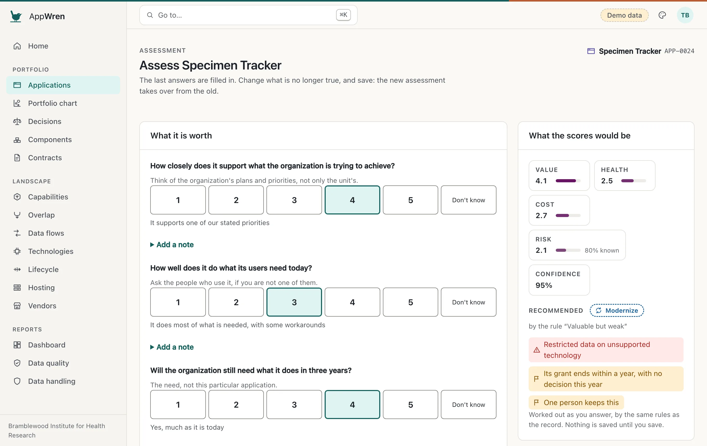

The people named on an application, the steward of its unit, architects, and managers may assess it. An assessment is never edited: the next one takes its place, and every one is kept.

An assessment is **current** for a period that depends on the tier: 12 months for tiers 1 and 2, 18 months for tier 3, and 24 months for tiers 4 and 5. After that its answers are shown, marked as expired, and count as unknown, and the application is flagged **Assessment expired**.

## The scores

Every application in service has four scores, each from 1 to 5, where **5 is always best for the organization**:

| Score | Asks | 5 means |
|---|---|---|
| **Business value** | How much would the organization lose without it? | A great deal |
| **Technical health** | How well is it built, run, and kept current? | Very well |
| **Cost and burden** | What does it take to keep? | Little |
| **Risk exposure** | What could go wrong while it is kept? | Little |

Each score is the weighted average of its **factors**. A factor comes from an answer (*strategic fit*), from a field (*criticality* from the tier, *security* from the sign-in method), from a number in bands (*reach*: fewer than 10 users is 1, at least 1,000 is 5), or from a calculation over the record (*technology currency* from the support dates of what its components run on; *capability uniqueness* from who else serves its capabilities; *cost per user* from its cost and the people who use it; *license use* from the contracts that cover it). [The engine](../spec/engine.md) lists every factor, its weight, and its levels.

### Unknown is not zero

A factor with no data is left out of its score, never assumed. The score is worked out from what is known, and **coverage** says how much of the score's weight that was. A score with less than half its weight known is **thin**: it is shown, with its coverage, and it cannot carry a recommendation.

**Data confidence** is the average coverage of the four scores. Below 70%, the recommendation is **Assess**. Beside it, AppWren lists **what would raise confidence**: each unknown factor, the heaviest first, with a link to where it is entered.

A factor can also be **not applicable**: vendor viability for software built here, or technology currency for a SaaS product. It is left out of the score and of the weight confidence is measured against, so it does not count against the application.

**A record nobody has confirmed is trusted less.** The people who keep an application confirm its record on a cadence by tier. Past that date the record is *stale*: data confidence loses 15 points, *Confirm the record* heads what would raise it, and the *Nobody has confirmed its record in time* flag is raised. Confirming it gives the points back. See [Confirm the record](keeping-current.md#confirm-the-record).

### The working

Choose any score to see how it was worked out: each factor, its level, its weight, and why it has that level (*Answered in the assessment*; *380 people: bands 10, 50, 250, 1,000*; *The only active application for Biospecimen management*), with any factor that is unknown or not applicable and the reason, and the sum. The Scores part shows the same for all four at once, with the assessment the answers came from and who gave it. Every figure can be redone by hand from what the screen shows. A value a connector or a push source supplied names its source, and the signals other tools supply, such as incidents or dependency alerts, count only where a source supplies them: see [Facts from other systems](signals.md#signals-in-the-scores).

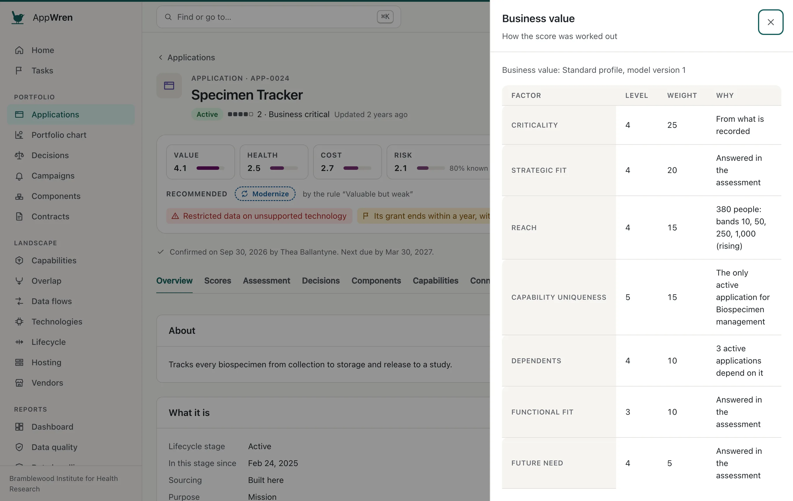

### Profiles

Not every application is judged by the same rubric. The scoring model has three **profiles**, and the first that matches applies:

| Profile | Applies to | What differs |
|---|---|---|
| **Foundation** | Shared platforms (purpose Foundation) | Judged on what rests on them: reach and dependents weigh more |
| **Research software** | Sourcing Research software | Judged on whether it can be kept going: sustainability and maintainability weigh more |
| **Standard** | Everything else | |

Some facts also set a **floor**: an application that active studies depend on, or that is a system of record for regulated information, has business value of at least 4.0. The working names the floor and why.

## Recommendations

The scores, the lifecycle stage, and the record together give a recommended **disposition**. Rules are tried in order, and the first that matches gives the recommendation; the Scores part names it.

| Disposition | When it is recommended | What it means |
|---|---|---|
| **Incubate** | Proposed, Evaluating, or Phase-in; or experimental and under a year old | New; not yet judged on use |
| **Assess** | Confidence under 70%, or value or health thin | Not enough is known to say |
| **Consolidate** | It does what a capability's primary provider does, and is worth less | Move its users to the primary |
| **Invest** | Value and health at least 3.0, and cost and burden at least 3.0 | Grow its capability and use |
| **Maintain** | Value and health at least 3.0, but costly to keep | Keep it as it is; review its cost |
| **Modernize** | Value at least 3.0, health under 3.0 | Valuable, but technically weak: upgrade, re-platform, or refactor |
| **Replace** | As Modernize, but vendor sourced with a vendor of doubtful viability | The function is needed; this product should go |
| **Tolerate** | Value under 3.0, health at least 3.0 | Keep it at the least cost, and look again |
| **Retire** | Value and health both under 3.0 | Little value: archive its data and decommission it |

A **guardrail** then protects what must not be retired without a successor: a *Retire* for an application of tier 1 or 2, the only provider of a capability, or a system of record for regulated information becomes **Replace**, and the working says a successor is needed.

Retired and archived applications are no longer scored.

### The portfolio chart

**Portfolio → Portfolio chart** places every scored application by business value against technical health, or against cost and burden. Each bubble is sized by its cost, where you may see costs, and colored by risk exposure. The threshold lines divide it into the quarters the rules use. Hover over a bubble to see which application it is and where it stands, and click it to open the application. A table beneath gives the exact figures for every application on the chart, and the applications too little is known about to place are listed after it.

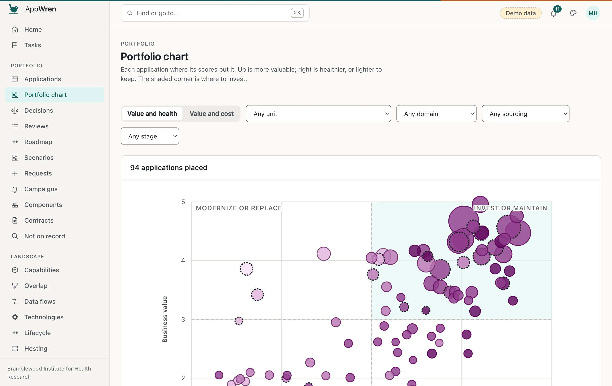

## Flags

Flags are raised whatever the recommendation. Each is a separate signal, with its own words, and names the facts that raised it.

| Flag | When |
|---|---|
| **Restricted data on unsupported technology** | It holds restricted data, and something it runs on is past end of support |
| **No accountable owner** | Nobody answers for it |
| **Grant ending** | It is paid for by a grant that ends within a year, and nobody has decided what to do with it this year |
| **One person keeps this** | Built here, low-code, or research software, tier 1 to 3, with one maintainer or none |
| **Assessment expired** | Its latest assessment is no longer current |
| **Decision review due** | The decision on record is past its review date |
| **Archive before retiring** | It is to be retired, replaced, or consolidated, and its data must be kept |
| **No data agreement** | It handles confidential or restricted data, and a contract that covers it needs a data agreement and has none |
| **Contract notice** | A contract that covers it has a notice date within 90 days |
| **Nobody has confirmed its record in time** | Its record is past its confirmation date; its data confidence is 15 points lower |
| **Cost review** | Valuable and healthy, but costly to keep |
| **Mismatch** | The decision on record differs from today's recommendation |

## Decisions

The engine recommends; a person decides. A **decision** records a disposition for an application by a named person, with a rationale, a date to review it (a year on, unless you choose another), and, if you wish, a target date. A decision to consolidate names the application its users will move to.

Managers record decisions for any application, and leaders for the applications of their units. Nobody records a decision about an application they are accountable for, unless the program lets owners decide (see [Shape it in the app](running-the-program.md#shape-it-in-the-app)); then each decision a manager or leader records about their own application is marked *Recorded by its own owner*.

To record one, open the application and choose **Record a decision**. The dialog shows the recommendation and its working beside the choice. A decision may be any disposition, whatever the recommendation: people know things the scores cannot.

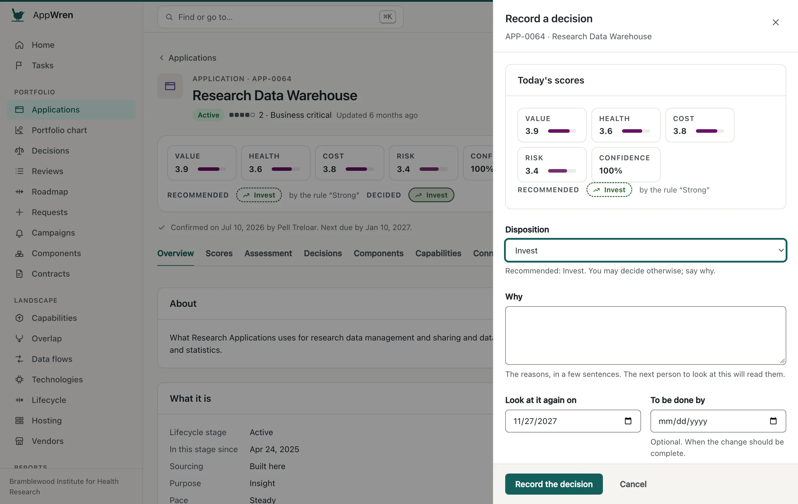

A decision keeps a **snapshot** of the scores it was made against, so it always shows exactly what its maker saw, even after the application or the program has changed. Decisions are never edited: a new one supersedes the last, and every one is kept on the Decisions part.

### Mismatches

When today's recommendation differs from the decision on record, the application shows a **mismatch**: both dispositions side by side, each with its working. A mismatch changes nothing on its own; it is a prompt for the next portfolio review. **Portfolio → Decisions** lists them, beside the decisions whose review date has come and the applications nobody has decided about yet.

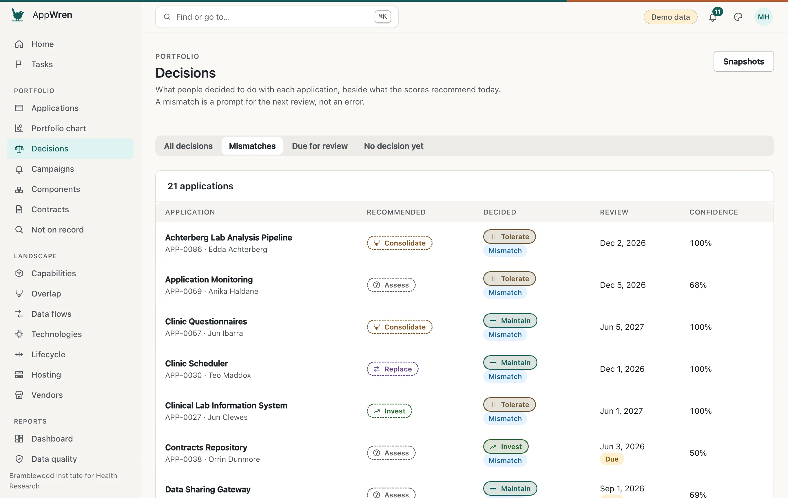

## Cost and contracts

### What it costs

An application's **Cost** part says what it costs a year, and how much that is for each person who uses it. The figure can be typed on the record as a rough estimate, or broken down into **cost lines**:

| A line says | |
|---|---|
| What it is for | A license or subscription, hosting, a support contract, your own people's time, or something else |
| How much a year | |
| What pays for it | A **funding source**: an operating budget, a grant, a chargeback, a capital project |
| The contract it falls under | Optional. Naming one makes that contract cover the application |

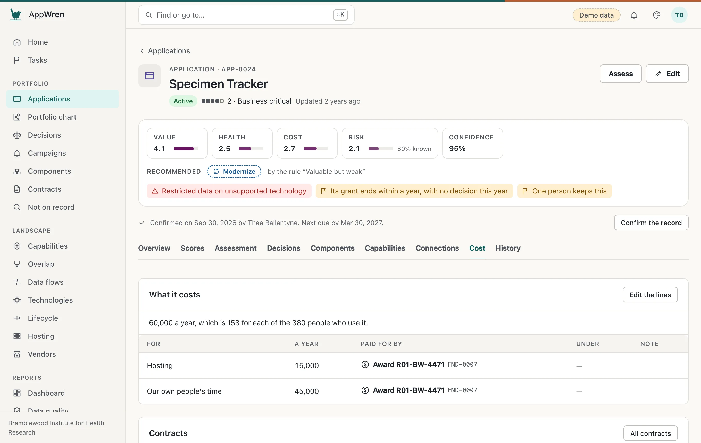

Choose **Break it down**, or **Edit the lines**, to change them. **Once an application has lines, its annual cost is their sum**, and the figure on the record can no longer be typed over. Include your own people's time: an application that costs nothing to license and half an engineer to keep is not free.

Cost is judged three ways in the *cost and burden* score: the yearly figure, the cost for each person who uses it, and, where a contract says how many licenses were bought, how many of them are in use.

Cost is **sensitive** by default. The Cost part, like annual cost itself, is shown to the people named on the application and those with a role over its unit; everyone else is told it is withheld. See [Who sees what](running-the-program.md#who-sees-what).

### Funding sources

Funding sources are kept by architects and managers, under **Portfolio → Contracts → Funding sources**. Each has a kind, a code such as a cost center or grant number, and, for a grant or a project, the day the money stops. Its page lists what it pays for.

### Contracts

**Portfolio → Contracts** holds the agreements with vendors that applications run under:

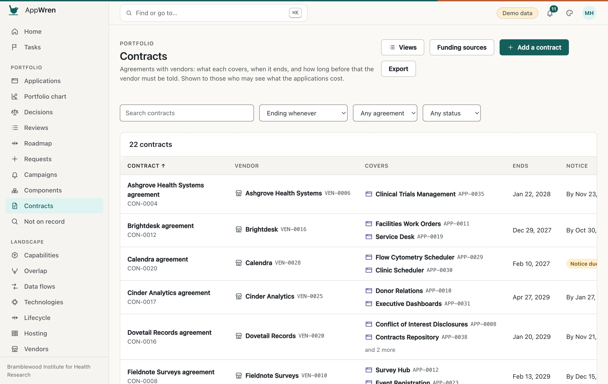

| | |
|---|---|
| **Vendor, number, start, and end** | The end is the end of the current term |
| **Notice, in days** | How long before the end the vendor must be told, if it is not to renew. The list shows the date this makes, and marks it when it is within 90 days or has passed |
| **Renews by itself** | Whether it renews unless someone says otherwise |
| **Yearly value** and **licenses bought** | |
| **Data agreement** | Whether an agreement covers the data the vendor handles: in place, not needed, or missing |
| **What it covers** | The applications, and how many of the licenses each uses |

Narrow the list to contracts ending within 90 days, six months, or a year. Stewards, architects, and managers add contracts; a contract is then kept by architects and managers, by whoever keeps an application it covers, and by its owner.

A contract is shown only to those who may see the cost of an application it covers, and to those who see every application's cost. Seen through one application, it does not name another you may not see.

Two flags come from contracts: **Contract notice**, when a contract that covers an application has a notice date within 90 days, and **No data agreement**, when the application handles confidential or restricted data and a contract that covers it is recorded as lacking one.

## Import and export

### Import applications

**Applications → Import** reads a CSV file:

1. Choose the file. AppWren reads its header and guesses which column is which field; correct any guess, or leave a column out.
2. Run it dry. Every problem is reported by row and column, and nothing is saved.
3. Import. All the rows are saved, or none of them.

A row whose reference is already on record updates that application, through the same checks as an edit by hand. Any other row adds one. The accountable owner is given by email address, and the vendor by name. A row that names nobody accountable is imported, and its application is flagged **No accountable owner**. A value for a sensitive field you may not see is refused.

Stewards, architects, and managers import, each for the units in their scope. A spreadsheet is read as data, never as formulas.

### Export

Every list can be exported as CSV from its **Export** button: applications, components, interfaces, deployments, contracts, funding sources, vendors, technologies, hosting platforms, capabilities, the applications that handle a class of data, and, from a list that a dashboard figure opens, the portfolio with its scores, recommendations, and decisions. The same exports come as JSON through the [API](api.md#reports-import-and-export). An export holds only what you may see, with the filters you have chosen. Values that a spreadsheet would treat as a formula are prefixed so that they are shown as text, and each export is recorded in the history.

## Next

- To see the whole portfolio's figures and what is missing from its records, read [Running the program](running-the-program.md#read-the-dashboard).
- To connect another system, read the [API guide](api.md).
